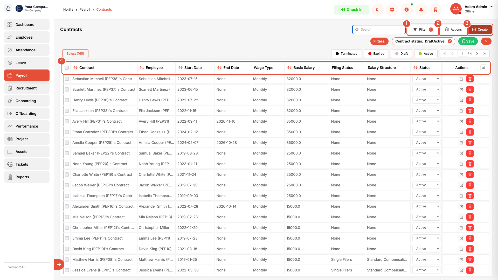

# **Contracts**

A contract sets an employee's pay terms. Payslips are built from it. Open it from **Payroll → Contracts**.

## **The page**

1. **Search** box.
2. **Filter** opens a panel with **Name or Badge ID, Employee, Wage Type** (*Daily, Monthly, Hourly*), **Filing Status**, **Pay Frequency** (*Weekly, Monthly, Semi-Monthly*) and **Status** (*Draft, Active, Expired, Terminated*), plus **Work Info** criteria and **Advanced** date and salary limits. The page opens with **Contract status: Draft, Active** applied.
3. **Actions** offers **Export** and **Delete**.
4. **Create** adds a contract.
5. The coloured dots (**Terminated, Expired, Draft, Active**) filter by status.
6. The table: **Contract, Employee, Start Date, End Date, Wage Type, Basic Salary, Filing Status, Salary Structure, Status** and **Actions** (**Update**, **Delete**).

The **Status** of each contract is shown as a drop-down in its row. The demo has 165 contracts matching the default filter.

## **Create a contract**

Click **Create**. The form has:

| Field | Required | Notes |
|---|---|---|
| **Contract** | Yes | A name, for example *Jessica Evans's Contract*. |
| **Employee** | Yes | Whose contract it is. |
| **Contract start date** | Yes | |
| **Contract end date** | No | Leave empty for an open-ended contract. |
| **Wage Type** | | **Daily, Monthly** or **Hourly**. Defaults to monthly. |
| **Pay Frequency** | | **Weekly, Monthly** or **Semi-Monthly**. |
| **Basic Salary** | Yes | |
| **Filing Status** | No | Chooses the [tax brackets](/hr/functional/v2.0/payroll/income-tax) that apply. |
| **Salary Structure** | No | A bundle of allowances and deductions from [Configuration](/hr/functional/v2.0/payroll/configuration). The demo has **Standard Compensation Package**. |
| **Department, Job Position, Job Role, Shift, Work Type** | No | Descriptive details. |
| **Notice Period** | Yes | In days. Defaults to 45. |
| **Contract Document** | No | An uploaded file. |
| **Deduct From Basic Pay**, **Calculate Daily Leave Amount** | | Switches affecting how leave is deducted. |
| **Deduction For One Leave Amount** | No | The amount deducted for one day of leave. |
| **Note** | No | |

::: info Not tested
Saving or changing a contract's status was not exercised, so the effect on payslips is not shown. How the leave-deduction switches work was not tested; they are described only by label.
:::
