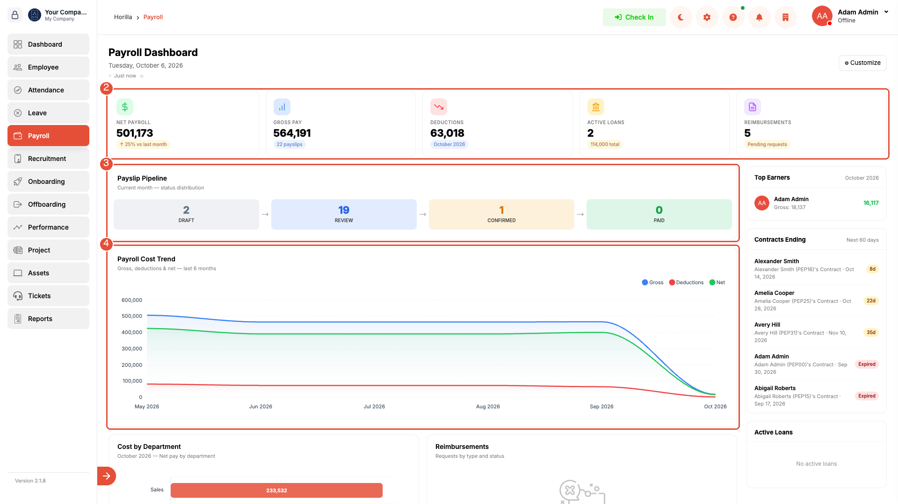
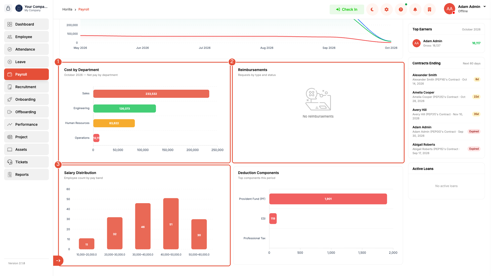

# **Payroll Dashboard**

The Payroll Dashboard summarises payroll for the current month. Open it from **Payroll → Dashboard**. **Customize** opens a panel for choosing which widgets appear.

1. **Customize** opens the widget panel.
2. Five summary cards:

   | Card | Reads in the demo | Caption |
   |---|---|---|
   | **Net Payroll** | 501,173 | *↑ 25% vs last month* |
   | **Gross Pay** | 564,191 | *22 payslips* |
   | **Deductions** | 63,018 | *October 2026* |
   | **Active Loans** | 2 | *114,000 total* |
   | **Reimbursements** | 5 | *Pending requests* |

3. **Payslip Pipeline** (*Current month, status distribution*) counts payslips in each status, **Draft** (2), **Review** (19), **Confirmed** (1) and **Paid** (0), with arrows showing the order they move through.
4. **Payroll Cost Trend** (*Gross, deductions & net, last 6 months*) charts the three amounts month by month.

1. **Cost by Department** shows the month's net pay for each department.
2. **Reimbursements** (*Requests by type and status*) charts reimbursement requests, or reads **No reimbursements**.
3. **Salary Distribution** (*Employee count by pay band*) shows how many employees fall in each pay band, for example *10,000–20,000* up to *50,000–60,000*.

1. **Deduction Components** (*Top components this period*) ranks deductions such as **Provident Fund (PF)**, **ESI** and **Professional Tax**.
2. **Top Earners** lists the highest-paid employees this month with their gross pay.
3. **Contracts Ending** (*Next 60 days*) lists contracts about to end, with the date and the days remaining (for example *Oct 14, 2026, 8d*).

::: info Not tested
Where each card or chart leads was not checked. Amounts on this page are shown without a currency symbol, while the [Payslips](/hr/functional/v2.0/payroll/payslips) list shows a **$**.
:::
