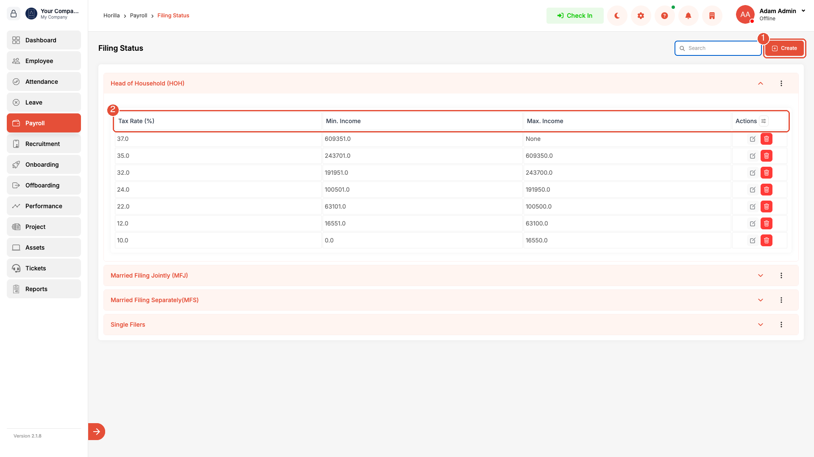

# **Income Tax**

Income Tax holds the tax brackets used for payroll, one set for each filing status. Open it from **Payroll → Income Tax**. The page itself is titled **Filing Status**.

1. **Create** adds to the list. A **Search** box sits beside it.
2. The brackets of the open filing status: **Tax Rate (%), Min. Income, Max. Income** and **Actions** (**Edit**, **Delete**).

The page is a set of collapsible sections, one per filing status: **Head of Household (HOH), Married Filing Jointly (MFJ), Married Filing Separately (MFS)** and **Single Filers**. Click a section's title to open or close it. Each section has a **⋮** menu at its right.

The demo's **Head of Household** brackets run from 10% (income 0 to 16,550) up to 37% (income from 609,351, with no maximum), in seven steps: 10, 12, 22, 24, 32, 35 and 37 percent.

A contract picks its bracket set through its **Filing Status** (see [Contracts](/hr/functional/v2.0/payroll/contracts)).

::: warning Sample data
These brackets are sample data. A bracket existing here does not make it correct for your country or tax year; set them from the rules that apply to your organisation.
:::

::: info Not tested
Creating a filing status or bracket, the **⋮** menus, and editing were not exercised, and how the brackets are applied when a payslip is calculated was not verified.
:::
