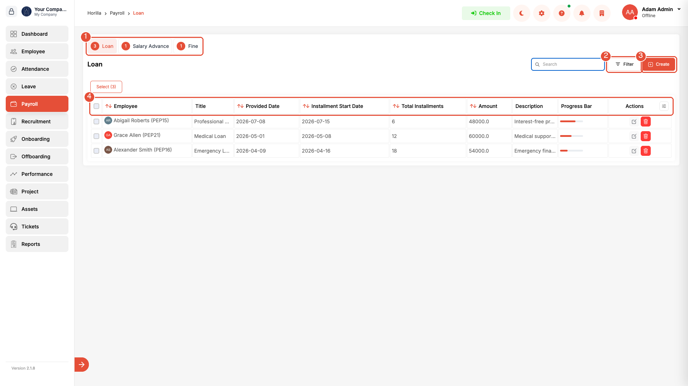

# **Loans & Salary Advances**

This page records money lent to employees and repaid in instalments. Open it from **Payroll → Loans & Salary Advances**. It has three tabs: **Loan**, **Salary Advance** and **Fine**.

1. The tabs. Each shows how many records it holds (in the demo, 3 loans, 1 salary advance and 1 fine).
2. **Filter** narrows the list.
3. **Create** adds a record on the current tab.
4. The table: **Employee, Title, Provided Date, Installment Start Date, Total Installments, Amount, Description, Progress Bar** and **Actions** (**Edit**, **Delete**). The **Progress Bar** column shows progress on the record.

All three tabs have the same columns and the same form; the tab you create on decides whether the record is a loan, an advance or a fine.

| Field | Required | Notes |
|---|---|---|
| **Title** | Yes | A name for the record. |
| **Employee** | Yes | Who it is for. |
| **Amount** | Yes | The total. |
| **Provided Date** | Yes | Defaults to today. |
| **Description** | Yes | |
| **Installment Amount** | No | The size of each repayment. |
| **Total Installments** | Yes | How many repayments. |
| **Installment Start Date** | Yes | When repayments begin. |

The [dashboard](/hr/functional/v2.0/payroll/dashboard)'s **Active Loans** card shows a count and a total (here 2 and 114,000).

::: info Not tested
Saving a record was not exercised, so how instalments are taken from payslips is not shown. The **Fine** type was not examined beyond its columns and form.
:::
