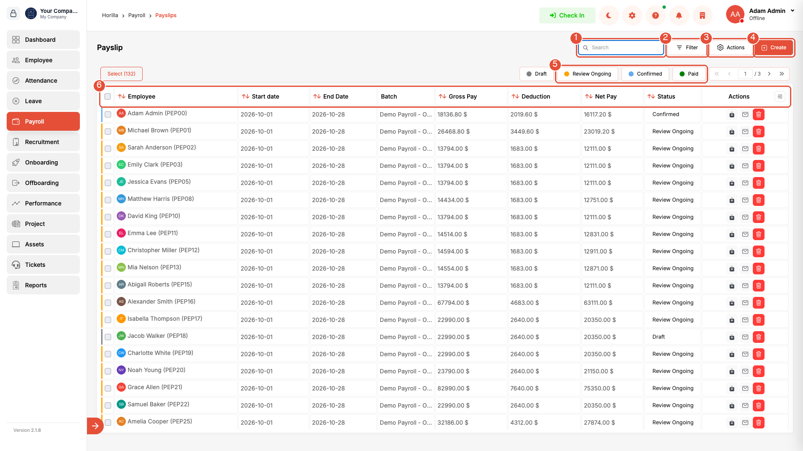
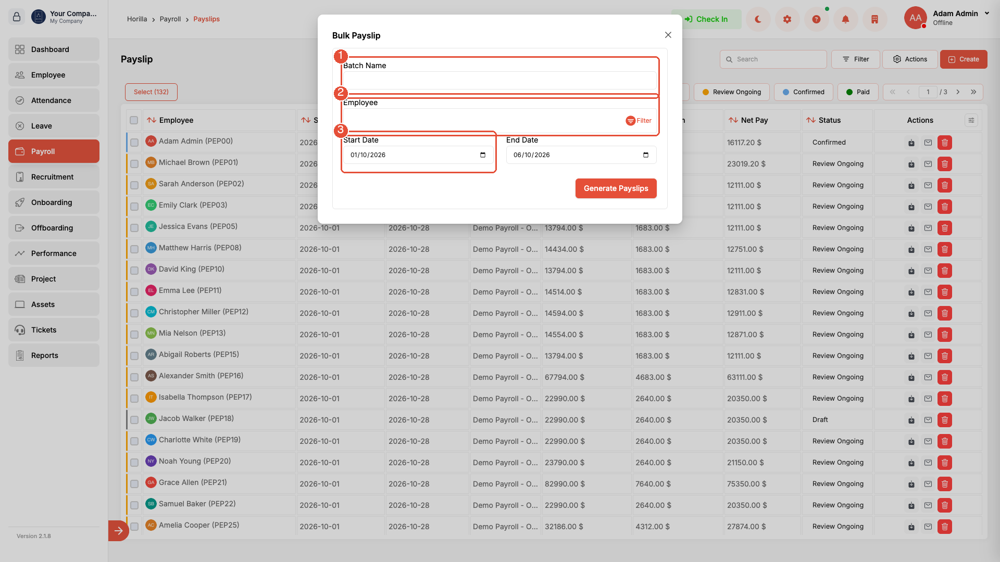

# **Payslips**

**Payslips** lists every generated payslip and is where payslips are generated, reviewed, sent and exported. Open it from **Payroll → Payslips**.

## **The page**

1. **Search** box.
2. **Filter** opens a panel with **Name or Badge ID, Employee, Status** (*Draft, Review Ongoing, Confirmed, Paid*), **Batch** and **Mail Sent** (*Unknown, Yes, No*). **Advanced** adds **Start Date** and **End Date** ranges and gross-pay, deduction and net-pay limits (each *less or equal* and *greater or equal*), and you can **Group By**.
3. **Actions** offers **Generate**, **Payslip Report**, **Send Via Mail**, **Export** and **Delete**.
4. **Create** opens the bulk payslip form.
5. The coloured dots (**Draft, Review Ongoing, Confirmed, Paid**) filter the list by status.
6. The table: **Employee, Start date, End Date, Batch, Gross Pay, Deduction, Net Pay, Status** and **Actions** (**Download**, **Send via mail**, **Remove**). Amounts carry a **$** sign in the demo.

The demo holds 132 payslips over three pages, in the batch **Demo Payroll - Oct 2026** (2026-10-01 to 2026-10-28).

## **Generate payslips**

**Create** and **Actions → Generate** open the same **Bulk Payslip** form.

| Field | Notes |
|---|---|
| **Batch Name** | A name for the group of payslips, for example *Payroll - Nov 2026*. |
| **Employee** | One or more employees. The picker has a **Filter** to narrow the list. |
| **Start Date**, **End Date** | The pay period. The start defaults to the first of the month and the end to today. |

Click **Generate Payslips**.

## **Payslip statuses**

| Status | Where you see it |
|---|---|
| **Draft** | Status column, status dots, dashboard pipeline |
| **Review Ongoing** | Shown as **Review** on the dashboard pipeline |
| **Confirmed** | Status column, status dots, dashboard pipeline |
| **Paid** | Status column, status dots, dashboard pipeline |

In the demo, most payslips are **Review Ongoing**, one is **Confirmed** and none is **Paid**.

::: info Not tested
Generating, confirming, sending, downloading and deleting payslips were not exercised. How a payslip moves from one status to the next, and what **Paid** triggers, is not described here. Recording a status is not the same as making a payment.
:::
