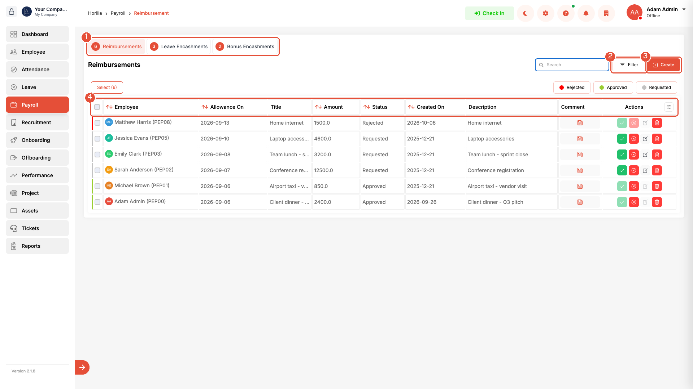
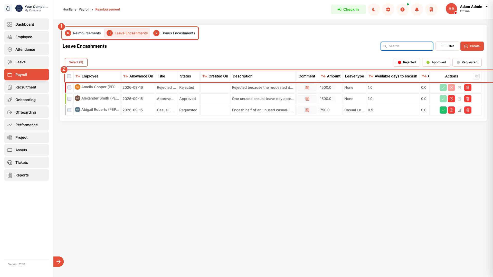

# **Encashments & Reimbursements**

This page handles payouts that are not regular salary: expense reimbursements, and leave or bonus-point encashments. Open it from **Payroll → Encashments & Reimbursements**. It has three tabs.

1. The tabs: **Reimbursements** (6 in the demo), **Leave Encashments** (3) and **Bonus Encashments** (2).
2. **Filter** narrows the list.
3. **Create** adds a request.
4. The table. Each row has an **Approve** icon, further icons and **Delete**.

## **Reimbursements**

Columns: **Employee, Allowance On, Title, Amount, Status, Created On, Description, Comment, Actions**.

| Field | Required | Notes |
|---|---|---|
| **Title** | Yes | What the expense was. |
| **Employee** | | Who it is for. |
| **Allowance On** | Yes | The date it should be paid with. |
| **Attachments** | Yes | A receipt or proof. |
| **Amount** | Yes | |
| **Description** | Yes | |

## **Leave Encashments**

Columns: **Employee, Allowance On, Title, Status, Created On, Description, Comment, Amount, Leave type, Available days to encash, Carryforward to encash, Actions**.

| Field | Required | Notes |
|---|---|---|
| **Title**, **Allowance On**, **Description** | Yes | |
| **Employee** | | Who is encashing leave. |
| **Leave Type** | | Only encashable leave types are offered (here **Casual Leave**). |
| **Available Days** | Yes | Days from the current balance. |
| **Carry Forward Days** | Yes | Days from the carried-forward balance. |

## **Bonus Encashments**

Columns: **Employee, Allowance On, Title, Status, Created On, Description, Comment, Amount, Bonus to encash, Actions**. The form has **Title, Employee, Allowance On, Bonus Points** (required) and **Description**. The value of each point is set under [Encashment Settings](/hr/functional/v2.0/payroll/configuration#encashment-settings).

::: info Not tested
Creating, approving and rejecting requests change real balances and payouts and were not exercised, so statuses and the effect on balances and payslips are not described.
:::
