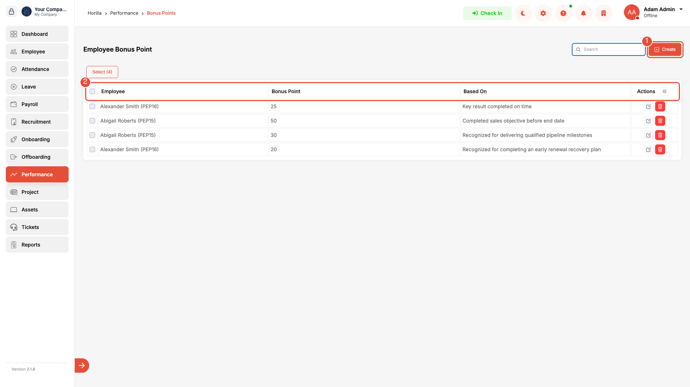

# **Bonus Points**

Bonus points reward employees for achievements. Open it from **Performance → Bonus Points**. The page is titled **Employee Bonus Point**.

1. **Create** awards points.
2. The table: **Employee, Bonus Point, Based On** and **Actions** (**Edit**, **Delete**). The demo holds four awards, for example *Abigail Roberts, 50, Completed sales objective before end date*.

| Field | Required | Notes |
|---|---|---|
| **Employee** | | Who receives the points. |
| **Bonus Points** | Yes | The number of points. |
| **Based On** | Yes | The reason, in free text. |

Points can also be awarded by rules; see [Performance Configuration](/hr/functional/v2.0/performance/configuration). Points can be redeemed through the [bonus encashment](/hr/functional/v2.0/payroll/reimbursements) feature in Payroll, and the employee's balance appears on the **Bonus Points** tab of their [profile](/hr/functional/v2.0/employee/employee-profile).

::: info Not tested
Awarding, editing and redeeming points were not exercised.
:::
