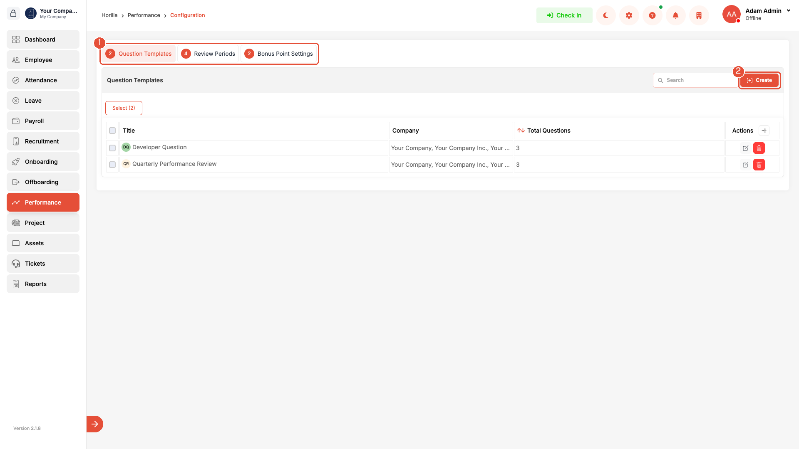
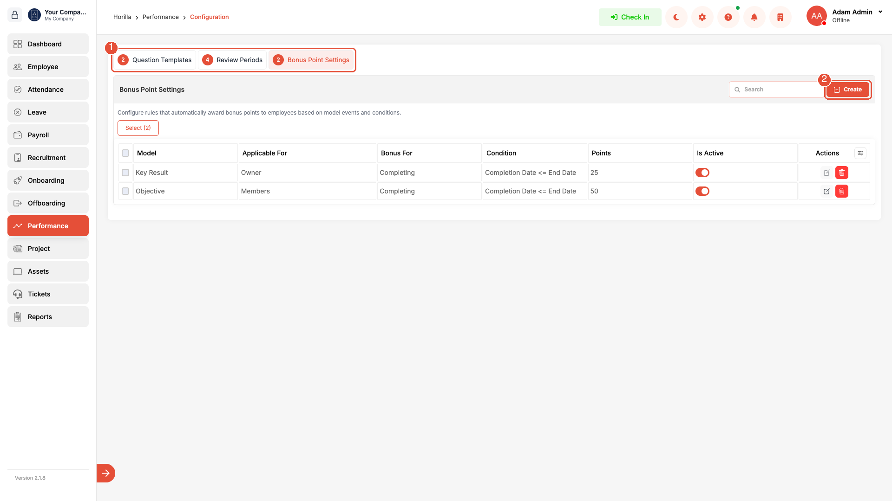

# **Performance Configuration**

**Performance → Configuration** holds the building blocks for feedback and bonus points. It has three tabs.

## **Question Templates**

1. The tabs, each with a count (2 question templates, 4 review periods and 2 bonus point settings in the demo).
2. **Create** adds an item.

The **Question Templates** table lists **Title, Company, Total Questions** and **Actions** (**Update**, **Delete**). The form asks for a **Question Template** name. The demo has **Developer Question** and **Quarterly Performance Review**. Templates are chosen when creating [feedback](/hr/functional/v2.0/performance/feedback) and [meetings](/hr/functional/v2.0/performance/meetings).

## **Review Periods**

The table lists **Title, Start Date, End date** and **Actions**. The form has a **Review Period Name**, a **Start date** and an **End date**, all required. The demo has **First Half 2024, Second Half 2024, Q3 2026 Performance Cycle** and **Q4 2026 Planning Cycle**.

## **Bonus Point Settings**

*Configure rules that automatically award bonus points to employees based on model events and conditions.* The table lists **Model, Applicable For, Bonus For, Condition, Points, Is Active** and **Actions**.

| Field | Required | Choices |
|---|---|---|
| **Model** | | **Objective, Key Result, Task, Project** |
| **Applicable For** | Yes | **Owner, Members, Managers** |
| **Bonus For** | Yes | **Completing, Closing** |
| **Field 1** | | **Completion Date** |
| **Conditions** | | **=, >, <, <=, >=** |
| **Field 2** | | **End Date** |
| **Points** | Yes | The number of points |

::: info Not tested
Creating and editing items was not exercised. When a bonus point rule fires, and what it compares, is described only by its field names.
:::
