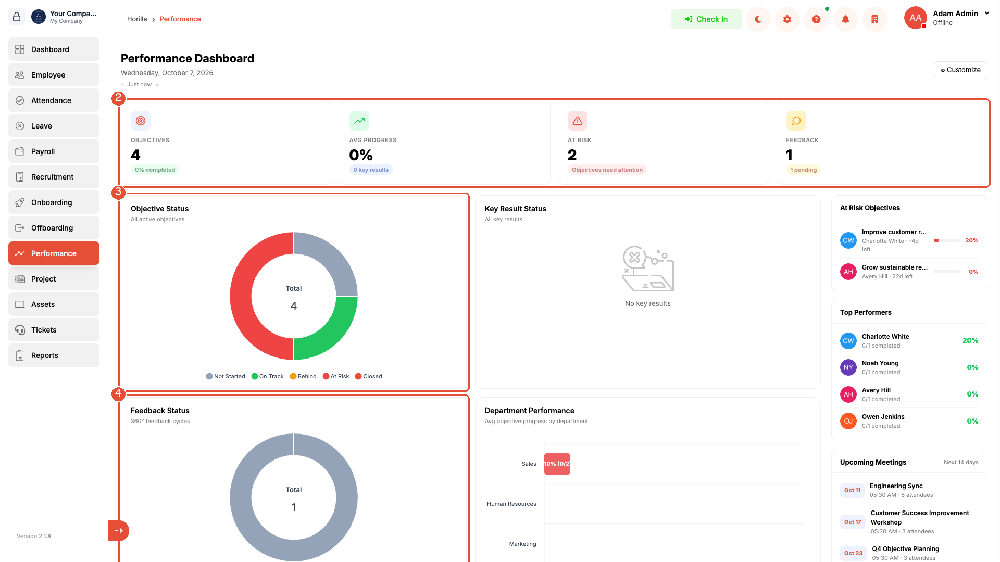
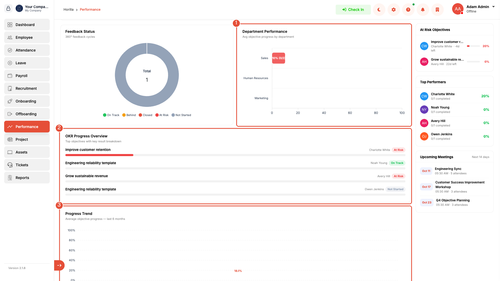
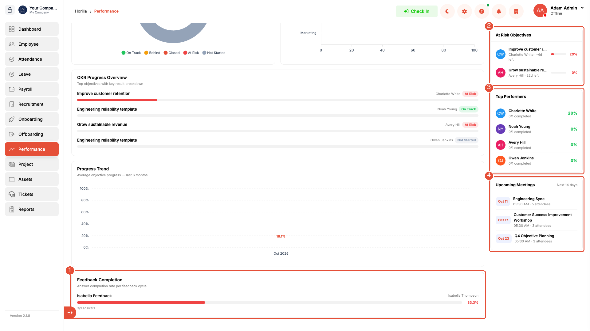

# **Performance Dashboard**

The Performance Dashboard summarises objectives, feedback and progress. Open it from **Performance → Dashboard**. **Customize** opens a panel to choose the widgets.

1. **Customize** opens the widget panel.
2. Four summary cards:

   | Card | Reads in the demo | Caption |
   |---|---|---|
   | **Objectives** | 4 | *0% completed* |
   | **Avg Progress** | 0% | *0 key results* |
   | **At Risk** | 2 | *Objectives need attention* |
   | **Feedback** | 1 | *1 pending* |

3. **Objective Status** (*All active objectives*) splits objectives into **Not Started, On Track, Behind, At Risk** and **Closed**.
4. **Feedback Status** (*360° feedback cycles*) splits feedback cycles by the same statuses.

The row also holds **Key Result Status** (*All key results*), which reads **No key results** in the demo.

1. **Department Performance** (*Avg objective progress by department*) shows each department's average with the numbers behind it, for example *10% (0/2)*.
2. **OKR Progress Overview** (*Top objectives with key result breakdown*) lists objectives with their owner and status, for example *Improve customer retention, At Risk*.
3. **Progress Trend** (*Average objective progress, last 6 months*).

1. **Feedback Completion** (*Answer completion rate per feedback cycle*) shows each cycle's completion, for example *33.3%, 3/9 answers*.
2. **At Risk Objectives** lists objectives at risk with the owner, days left and progress.
3. **Top Performers** ranks employees by objectives completed and progress.
4. **Upcoming Meetings** (*Next 14 days*) lists meetings with their dates.

::: info Not tested
Where cards and charts lead was not checked. In the demo the **Objectives** card counts 4 while the [Employee Objectives](/hr/functional/v2.0/performance/objectives) page lists none, so check which records a figure covers before relying on it.
:::
