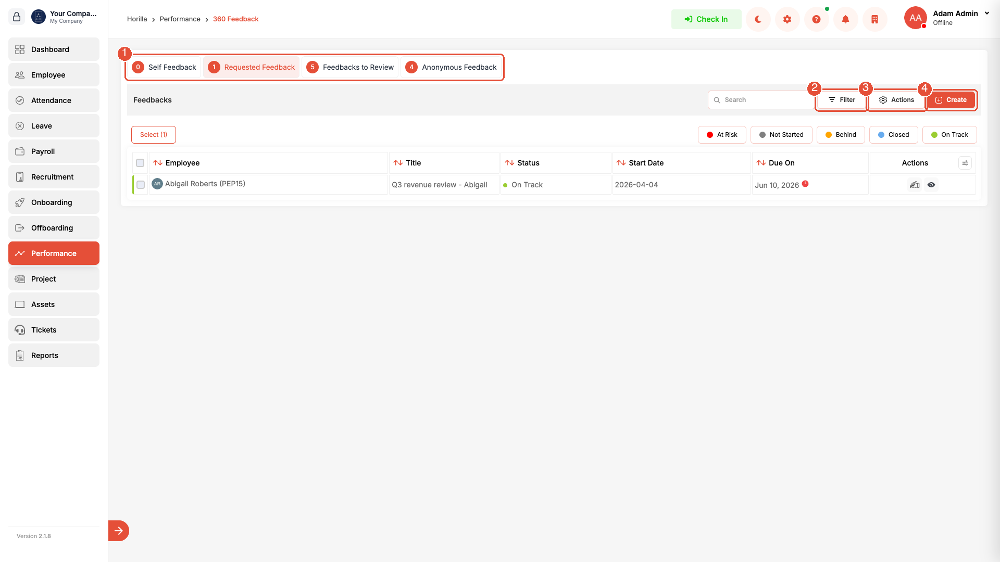
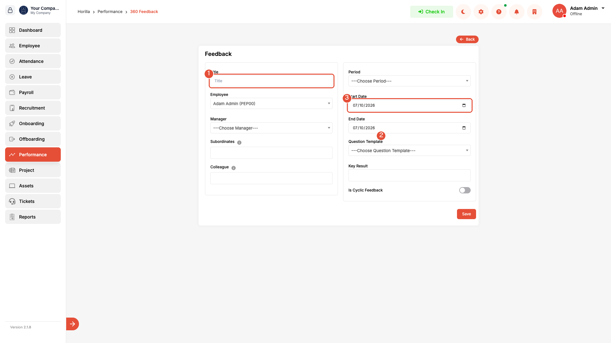
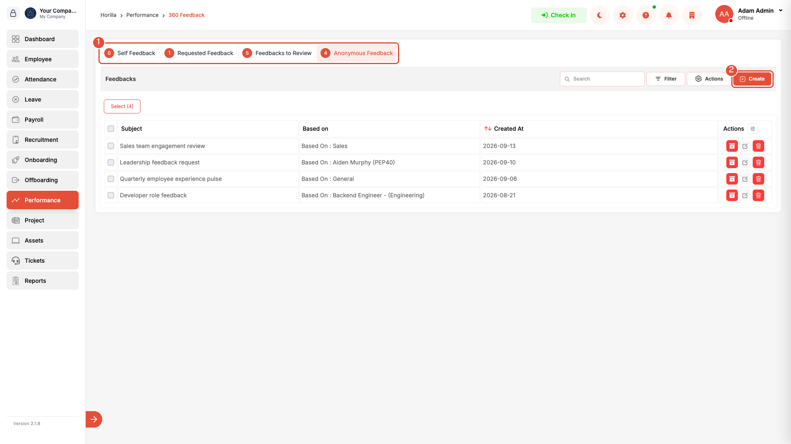

# **360 Feedback**

360° feedback gathers views on an employee from several people. Open it from **Performance → 360 Feedback**. It has four tabs.

1. The tabs: **Self Feedback** (0 in the demo), **Requested Feedback** (1), **Feedbacks to Review** (5) and **Anonymous Feedback** (4).
2. **Filter** opens a panel with **Feedback, Employee, Manager, Subordinate, Colleague, Status** (*On Track, Behind, Closed, At Risk, Not Started*), **In Offboarding?** and **Archive**.
3. **Actions** and 4. **Create** are on every tab.

| Tab | Columns | Row actions |
|---|---|---|
| **Self Feedback** | Empty in the demo | |
| **Requested Feedback** | **Employee, Title, Status, Start Date, Due On, Actions** | **Answer**, **Answer view** |
| **Feedbacks to Review** | **Employee, Title, Status, Start Date, Due On, Actions** | **Archive**, **Delete** |
| **Anonymous Feedback** | **Subject, Based on, Created At, Actions** | **Archive**, **Edit**, **Delete** |

## **Create a feedback cycle**

On the **Self Feedback** tab, **Create** opens a **Feedback** page with a **Back** button.

| Field | Required | Notes |
|---|---|---|
| **Title** | Yes | The cycle's name. |
| **Employee** | Yes | Who the feedback is about. |
| **Manager** | No | |
| **Subordinates**, **Colleague** | No | The other people asked to give feedback. |
| **Period** | No | A review period, for example *Q3 2026 Performance Cycle*, or **Create new period**. |
| **Start Date**, **End Date** | Yes | The window for answers. |
| **Question Template** | Yes | The questions asked, for example *Developer Question* or *Quarterly Performance Review*. |
| **Key Result** | No | |
| **Is Cyclic Feedback** | | A switch for feedback that repeats; it adds **Cycle Period** and **Cyclic Feedback Period** (*Days, Months, Years*). |

## **Anonymous feedback**

An anonymous feedback entry has a **Feedback Subject** (required), **Based On** (*General, Employee, Department, Job Position*), the matching **Employee, Department** or **Job Position**, and a **Feedback Description**.

::: info Not tested
Answering, reviewing and creating feedback were not exercised. The page does not say who can see an anonymous submission or its author, and that was not checked, so this guide makes no claim about it.
:::
