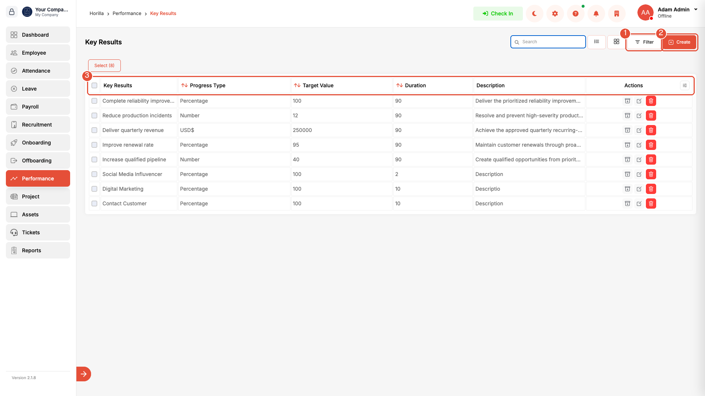
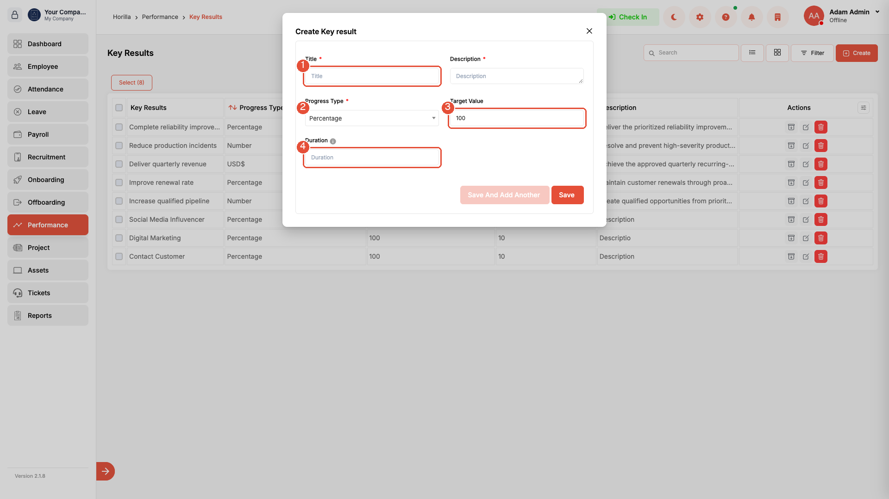

# **Key Results**

A key result is a measurable outcome with a target. Objectives are built from them. Open it from **Performance → Key Results**.

1. **Filter** opens a panel with **Key Result, Company, Progress Type** (*Percentage, Number, USD$, INR, EUR*), **Target Value, Duration** and **Is Active**, plus **+ Add filter** and **Group By**.
2. **Create** adds a key result.
3. The table: **Key Results, Progress Type, Target Value, Duration, Description** and **Actions** (**Archive, Edit, Delete**). The demo holds eight, for example **Reduce production incidents** (*Number*, target 12, duration 90) and **Deliver quarterly revenue** (*USD$*, target 250000).

## **Create a key result**

| Field | Required | Notes |
|---|---|---|
| **Title** | Yes | |
| **Description** | Yes | |
| **Progress Type** | | How progress is measured: **Percentage, Number, USD$, INR** or **EUR**. Defaults to percentage. |
| **Target Value** | | The goal in that unit. Defaults to 100. |
| **Duration** | | A number of days in the demo's examples. |

::: info Not tested
Saving and archiving were not exercised.
:::
