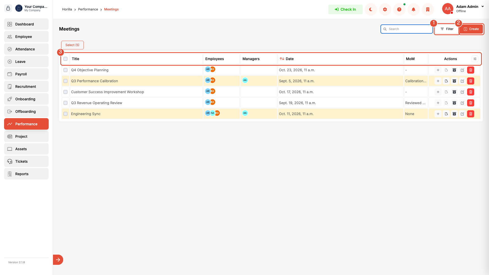
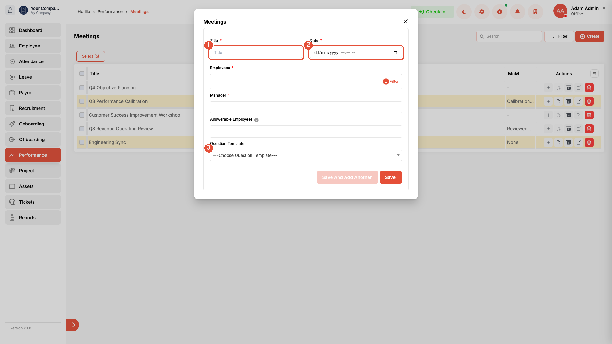

# **Meetings**

Meetings records performance conversations and their minutes. Open it from **Performance → Meetings**.

1. **Filter** opens a panel with **Meeting, Employee, Manager, Question Template, Date, Is Active**, a **Work Information** section and **Advanced** date limits.
2. **Create** schedules a meeting.
3. The table: **Title, Employees, Managers, Date, MoM** (minutes of meeting) and **Actions**. Each row has icons including **Add MoM**, **Answer**, **Archive** and **Edit**. The demo holds five, for example *Q4 Objective Planning* (23 October 2026) and *Q3 Performance Calibration* (5 September 2026), the latter with recorded minutes.

## **Schedule a meeting**

| Field | Required | Notes |
|---|---|---|
| **Title** | Yes | |
| **Date** | Yes | Date and time. |
| **Employees** | No | The attendees. |
| **Manager** | Yes | |
| **Answerable Employees** | No | Employees who can answer the meeting's questions. |
| **Question Template** | No | *Developer Question* or *Quarterly Performance Review*. |

::: info Not tested
Scheduling, adding minutes and answering were not exercised.
:::
