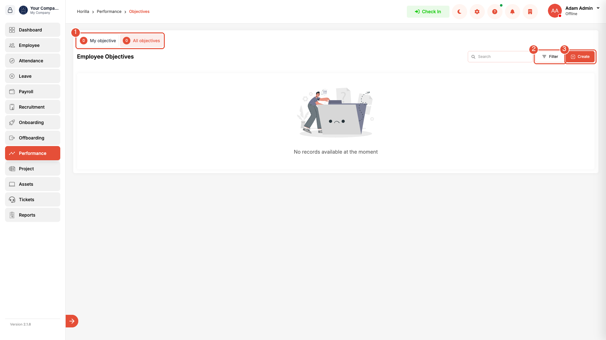
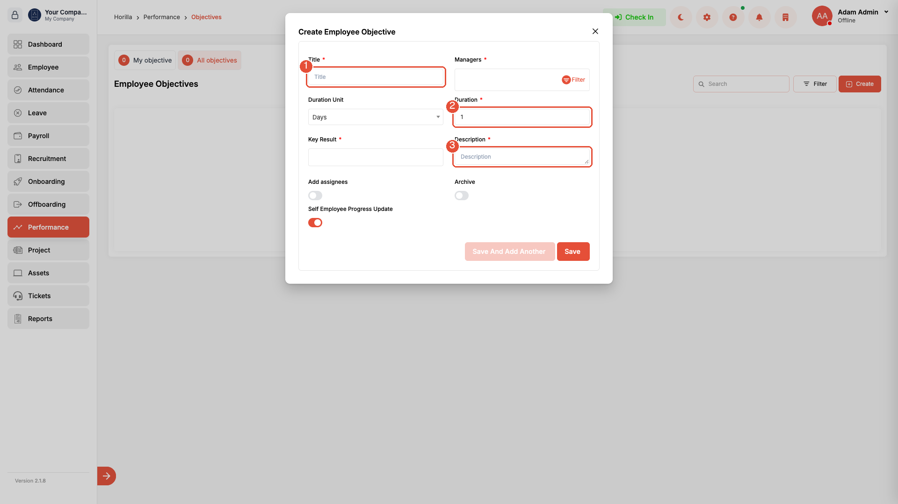

# **Employee Objectives**

An objective is a goal assigned to people, made of one or more key results. Open it from **Performance → Employee objective**. The page has two tabs: **My objective** and **All objectives**.

1. The tabs, each with a count.
2. **Filter** opens a panel with **Objective, Managers, Assignees, Key Result, Duration** and **Is Archived** (*Unknown, Yes, No*), plus **+ Add filter** and **Group By**.
3. **Create** adds an objective.

Both tabs read **No records available at the moment** in the demo, although the dashboard counts four objectives.

## **Create an objective**

| Field | Required | Notes |
|---|---|---|
| **Title** | Yes | The goal's name. |
| **Managers** | No | Who oversees it. |
| **Duration Unit** | | **Days, Months** or **Years**. |
| **Duration** | Yes | How long, in that unit. Defaults to 1. |
| **Key Result** | Yes | One or more key results from [Key Results](/hr/functional/v2.0/performance/key-results). |
| **Description** | Yes | |
| **Assignees** | No | The employees responsible. |
| **Start date** | No | Defaults to today. |

::: info Not tested
Saving an objective was not exercised, so how progress is recorded and how an objective's status (*On Track, At Risk* and so on) is set is not described.
:::
