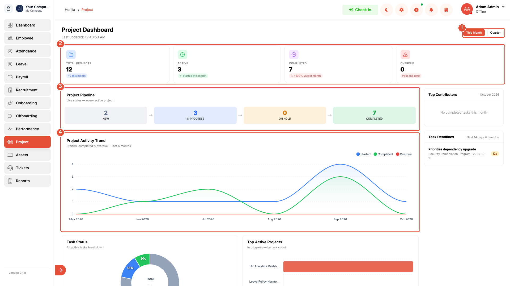
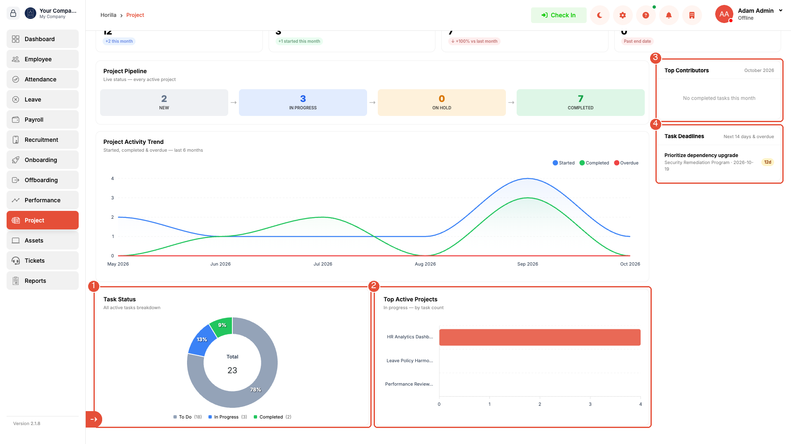

# **Project Dashboard**

The Project Dashboard summarises projects and tasks. Open it from **Project → Dashboard**. A **This Month / Quarter** switch at the top sets the period, and the page shows a *Last updated* time.

1. The period switch (**This Month**, **Quarter**).
2. Four summary cards:

   | Card | Reads in the demo | Caption |
   |---|---|---|
   | **Total Projects** | 12 | *+2 this month* |
   | **Active** | 3 | *+1 started this month* |
   | **Completed** | 7 | *vs last month* |
   | **Overdue** | 0 | *Past end date* |

3. **Project Pipeline** (*Live status, every active project*) counts projects by status with arrows showing the order: **New** (2), **In Progress** (3), **On Hold** (0), **Completed** (7).
4. **Project Activity Trend** (*Started, completed & overdue, last 6 months*).

1. **Task Status** (*All active tasks breakdown*) splits 23 tasks into **To Do** (18), **In Progress** (3) and **Completed** (2).
2. **Top Active Projects** (*In progress, by task count*).
3. **Top Contributors** (*October 2026*), or *No completed tasks this month*.
4. **Task Deadlines** (*Next 14 days & overdue*) lists tasks with their project, due date and days left.

::: info Not tested
Where cards and charts lead was not checked.
:::
