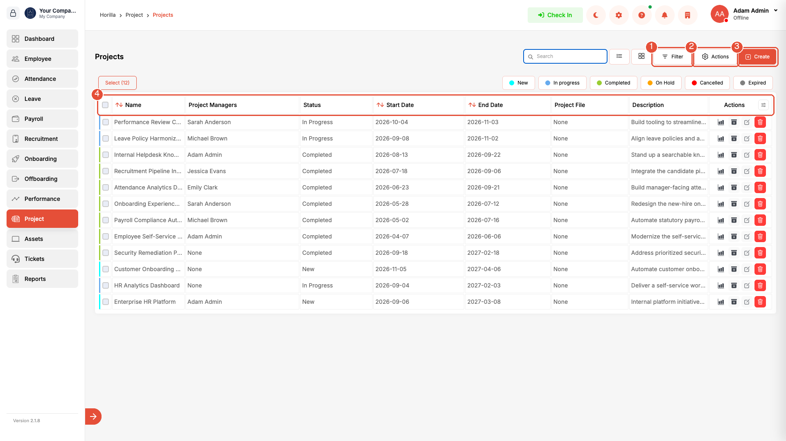
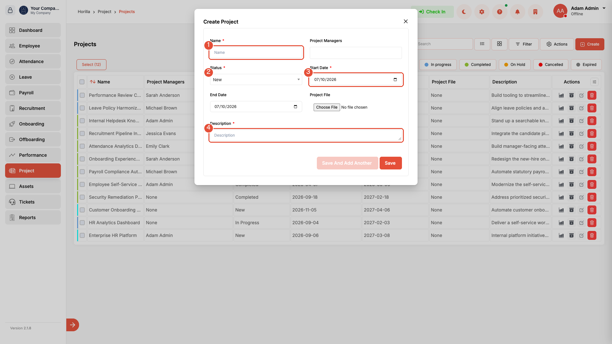
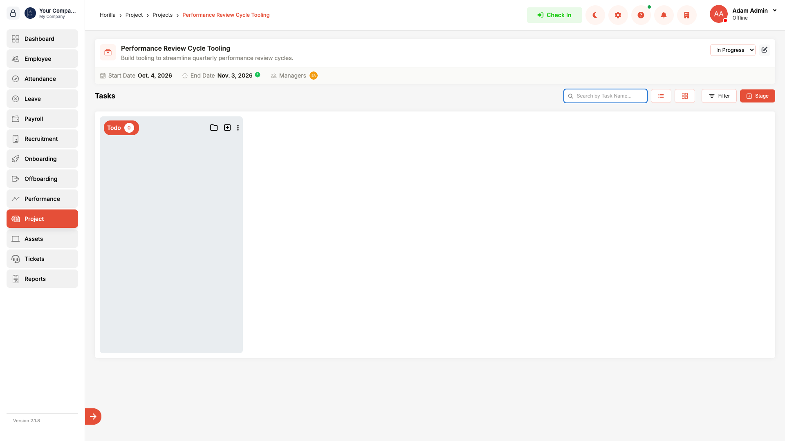

# **Projects**

**Projects** lists every project. Open it from **Project → Projects**.

## **The list**

1. **Filter** opens a panel with **Project, Name or Badge ID, Project Managers, Status** (*New, In Progress, Completed, On Hold, Cancelled, Expired*) and **Is Active**, plus **Advanced** start and end limits and **Group By**.
2. **Actions** offers **Import, Export, Archive, Un-archive** and **Delete**.
3. **Create** adds a project.
4. The table: **Name, Project Managers, Status, Start Date, End Date, Project File, Description** and **Actions**.

The coloured dots filter by status, and the list can be shown as a **List** or **Card** layout. The demo has 12 projects, for example **Performance Review Cycle Tooling** (In Progress) and **Internal Helpdesk Knowledge Base** (Completed). Each row has icons for **Timesheets**, **Archive**, edit and delete.

## **Create a project**

| Field | Required | Notes |
|---|---|---|
| **Name** | Yes | |
| **Project Managers** | No | One or more employees. |
| **Status** | | **New, In Progress, Completed, On Hold, Cancelled** or **Expired**. Defaults to *New*. |
| **Start Date** | Yes | |
| **End Date** | No | |
| **Project File** | No | An attachment. |
| **Description** | Yes | |

## **A project's board**

Click a project to open its board.

The header shows the project's name and description, a **status** drop-down, an edit icon, the **Start Date**, **End Date** and **Managers**. Below it, **Tasks** has a **Search by Task Name** box, a switch between the board and list layouts, a **Filter**, and a **Stage** button that adds a stage. Each stage is a column headed by its name and a task count (here **Todo**, empty), with icons to add a task and a **⋮** menu.

::: info Not tested
Creating, importing, archiving and deleting projects, changing a status and adding stages were not exercised.
:::
