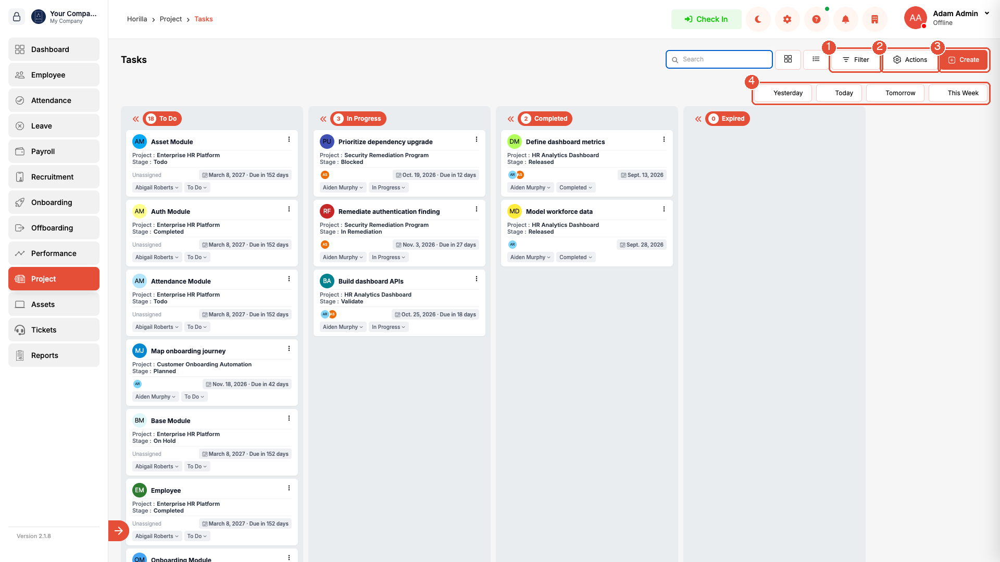
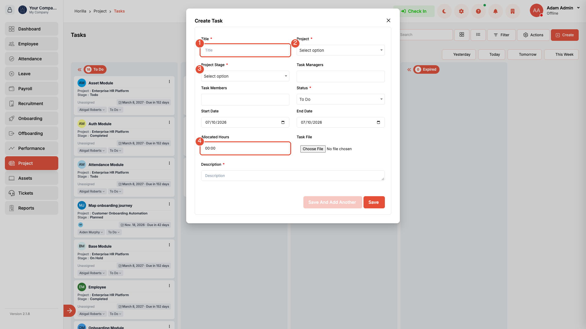

# **Tasks**

**Tasks** lists the tasks of every project. Open it from **Project → Tasks**.

1. **Filter** opens a panel with **Task, Project, Project Stage, Task Managers, Task Members**, and under **Advanced** **Status** (*To Do, In Progress, Completed, Expired*), **Is Active** and **End Date** limits, plus **Group By**.
2. **Actions** offers **Archive, Un-Archive** and **Delete**.
3. **Create** adds a task.
4. The quick filters **Yesterday, Today, Tomorrow** and **This Week** show tasks due then. Tasks can be shown as **cards** or as a **list**.

Each card shows the task's name, its **Project** and **Stage**, the people on it (or *Unassigned*), the due date with the days remaining (for example *Due in 152 days*) and its status. The demo holds 23 active tasks, for example **Asset Module** in *Enterprise HR Platform*.

## **Create a task**

| Field | Required | Notes |
|---|---|---|
| **Title** | Yes | |
| **Project** | Yes | The project it belongs to. |
| **Project Stage** | Yes | The stage column it sits in; choices include *Todo, In Progress, Completed, Cancelled, On Hold, Planned, Build, Validate, Released*. |
| **Task Managers**, **Task Members** | No | Who runs it and who works on it. |
| **Status** | | **To Do, In Progress, Completed** or **Expired**. Defaults to *To Do*. |
| **Start Date**, **End Date** | No | |
| **Allocated Hours** | No | Planned hours, as *HH:MM*. |
| **Task File** | No | An attachment. |
| **Description** | Yes | |

::: info Not tested
Saving, archiving and deleting tasks were not exercised. How a task's status relates to its stage was not checked.
:::
