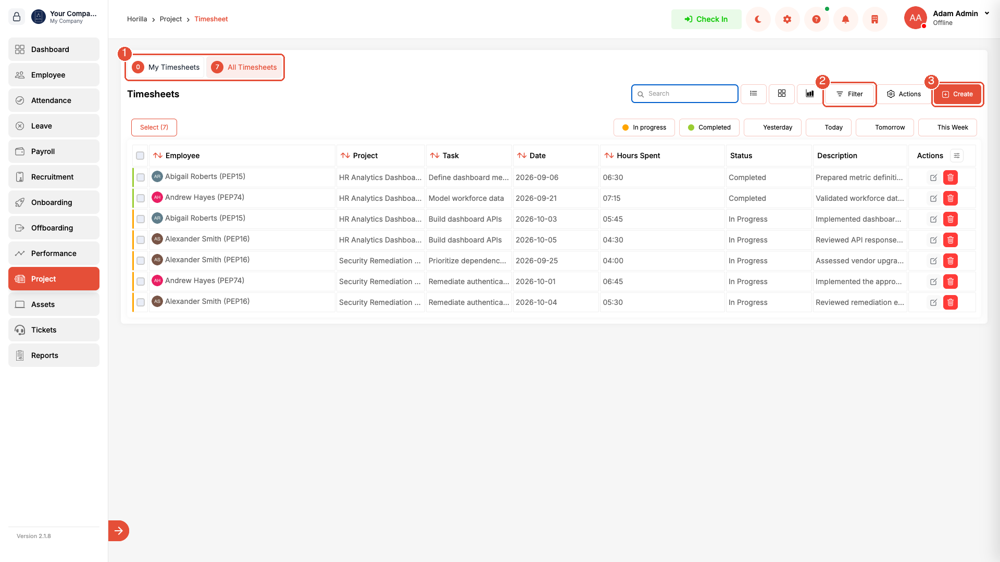

# **Timesheets**

Timesheets record the hours spent on tasks. Open it from **Project → Timesheet**. It has two tabs: **My Timesheets** and **All Timesheets**.

1. The tabs. Both read **No records available at the moment** in the demo.
2. **Filter** opens a panel with **Timesheet, Project, Task, Employee, Status** (*In Progress, Completed*), **Date**, and under **Advanced** **Start Date From** and **End Date Till**, plus **Group By**.
3. **Create** adds a timesheet entry.

Status dots (**In progress, Completed**) and quick filters (**Yesterday, Today, Tomorrow, This Week**) narrow the list.

| Field | Required | Notes |
|---|---|---|
| **Project** | Yes | |
| **Task** | Yes | Chosen after the project. |
| **Employee** | Yes | |
| **Date** | Yes | Defaults to today. |
| **Hours Spent** | Yes | As *HH:MM*. |
| **Status** | | **In Progress** or **Completed**. |
| **Description** | No | |

A project row on the [Projects](/hr/functional/v2.0/project/projects) list has a **Timesheets** icon that opens the timesheets for that project.

::: info Not tested
Creating entries was not exercised, and the demo has no timesheets, so a populated list is not shown.
:::
