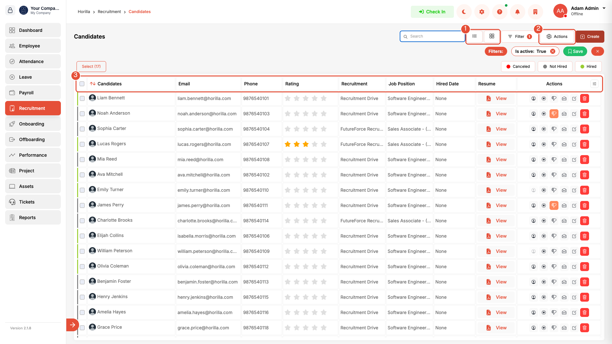

# **Candidates**

**Candidates** lists everyone who has applied. Open it from **Recruitment → Candidates**.

1. A switch between the **list** and **card** layouts.
2. **Actions** offers **Export, Bulk mail, Create document request, Archive, Un-archive** and **Delete** for the rows you tick.
3. The table: **Candidates, Email, Phone, Rating, Recruitment, Job Position, Hired Date, Resume** and **Actions**.

**Filter** (the badge shows the filters on) opens a panel with **Candidates, Rejection Reason, Phone, Hired Date, Country** and more, plus **Advanced** options. The coloured dots (**Canceled, Not Hired, Hired**) filter by outcome. The demo lists 17 candidates.

Each row has icons for **View, To employee, To Talent Pool, Add To Rejected Candidates, Send Mail, Edit** and **Delete**. There is no **Create** button on this page: candidates enter through an application, and their cards then appear in the [pipeline](/hr/functional/v2.0/recruitment/pipeline).

The row icons are the main ways a candidate leaves the pipeline:

| Icon | Meaning |
|---|---|
| **To employee** | Take the candidate on as an employee |
| **To Talent Pool** | Save the candidate in a [talent pool](/hr/functional/v2.0/recruitment/talent-pool) |
| **Add To Rejected Candidates** | Record a rejection |

::: info Not tested
These actions change real records and send messages, so none was used. What **To employee** creates, and how a candidate is rejected, is not described beyond the icon's name.
:::
