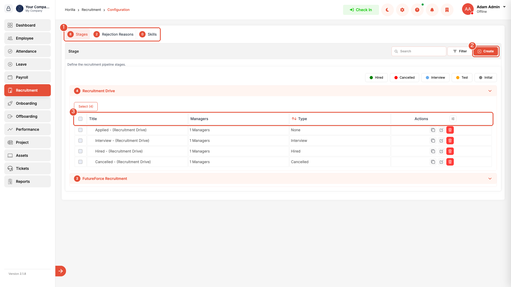
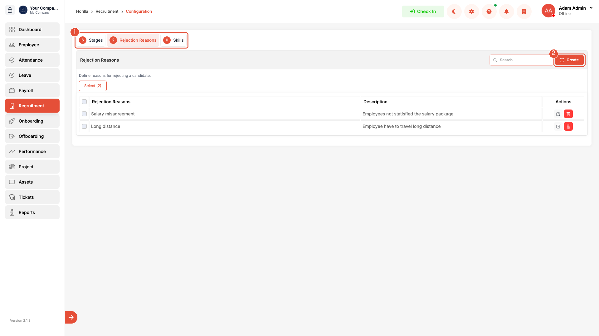

# **Recruitment Configuration**

**Recruitment → Configuration** defines the stages candidates pass through, the reasons for rejecting them, and the skills list. It has three tabs.

## **Stages**

*Define the recruitment pipeline stages.*

1. The tabs, with a count on each (6 stages, 2 rejection reasons, 0 skills in the demo).
2. **Create** adds a stage.
3. The table: **Title, Managers, Type** and **Actions** (**Duplicate**, **Edit**, **Remove**).

| Field | Required | Notes |
|---|---|---|
| **Stage Managers** | Yes | Employees responsible for the stage. |
| **Stage** | Yes | The stage's name. |
| **Stage Type** | | **Initial, Applied, Test, Interview, Cancelled** or **Hired**. The same six names appear as the stages on the dashboard funnel. |

## **Rejection Reasons**

*Define reasons for rejecting a candidate.* The table lists **Rejection Reasons, Description** and **Actions**. The form has a **Title** (required) and a **Description**.

## **Skills**

*Manage the list of skills available for candidates and employees.* The tab is empty in the demo (*No records available at the moment*). The form has just a **Title** (required). Skills chosen here are offered in the **Skills** field of a [job opening](/hr/functional/v2.0/recruitment/job-openings).

::: info Not tested
Creating, duplicating and removing stages, reasons and skills were not exercised. Removing a stage that candidates are in was not tried.
:::
