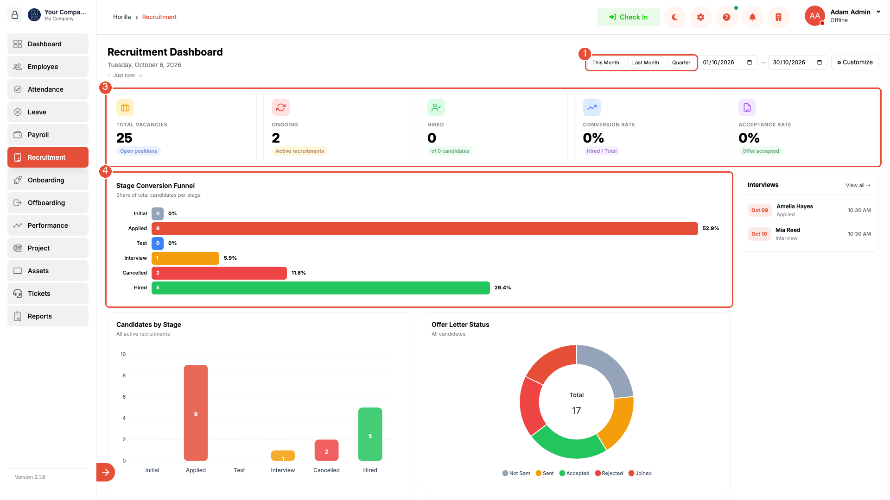
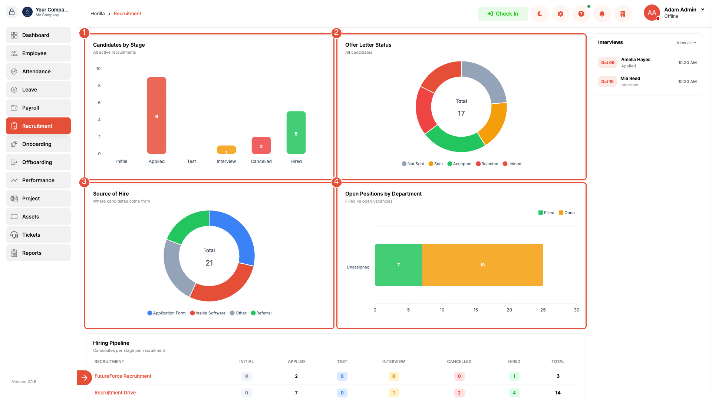
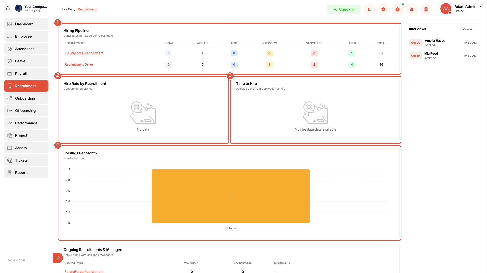
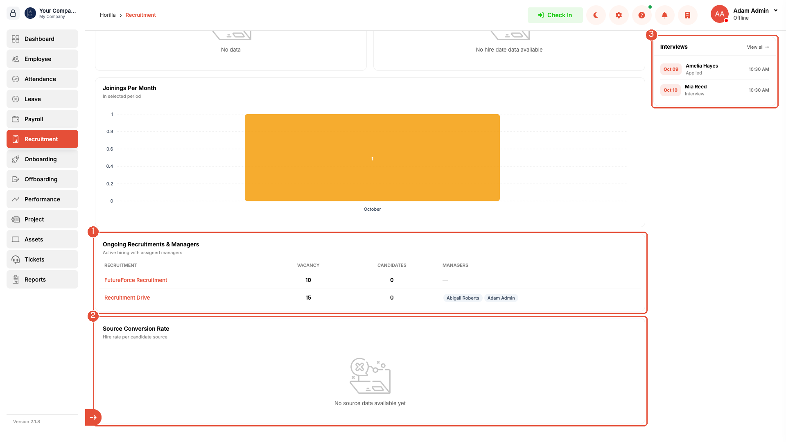

# **Recruitment Dashboard**

The Recruitment Dashboard summarises hiring. Open it from **Recruitment → Dashboard**. A date range at the top (**This Month, Last Month, Quarter**, or a custom range with a **→** button) controls the period shown, and **Customize** opens the widget panel.

## **Summary cards and funnel**

1. The period presets.
2. **Customize** opens the widget panel.
3. Five summary cards:

   | Card | Reads in the demo | Caption |
   |---|---|---|
   | **Total Vacancies** | 25 | *Open positions* |
   | **Ongoing** | 2 | *Active recruitments* |
   | **Hired** | 0 | *of 0 candidates* |
   | **Conversion Rate** | 0% | *Hired / Total* |
   | **Acceptance Rate** | 0% | *Offer accepted* |

4. **Stage Conversion Funnel** (*Share of total candidates per stage*) lists the stages with a count and percentage, for example **Applied** 9 (52.9%), **Interview** 1 (5.9%), **Cancelled** 2 (11.8%) and **Hired** 5 (29.4%).

1. **Candidates by Stage** (*All active recruitments*) charts candidates in each stage.
2. **Offer Letter Status** (*All candidates*) splits candidates into **Not Sent, Sent, Accepted, Rejected** and **Joined** (17 in total in the demo).
3. **Source of Hire** (*Where candidates come from*) splits them by source: **Application Form, Inside Software, Other, Referral**.
4. **Open Positions by Department** (*Filled vs open vacancies*).

1. **Hiring Pipeline** (*Candidates per stage per recruitment*) is a table with a row for each recruitment and a count for each stage.
2. **Hire Rate by Recruitment** (*Conversion efficiency*), or **No data**.
3. **Time to Hire** (*Average days from application to hire*), or *No hire date data available*.
4. **Joinings Per Month** (*In selected period*).

1. **Ongoing Recruitments & Managers** lists each active recruitment with its vacancy, candidate count and managers.
2. **Source Conversion Rate** (*Hire rate per candidate source*), or *No source data available yet*.
3. **Interviews** lists upcoming interviews with date, candidate, stage and time. **View all** opens [Interviews](/hr/functional/v2.0/recruitment/interviews).

::: info Not tested
Where each card and chart leads was not checked. In the demo, the **Hired** card reads 0 while the funnel counts 5 hired, so the cards and the charts do not always cover the same candidates. Check which period and recruitments a figure covers before relying on it.
:::
