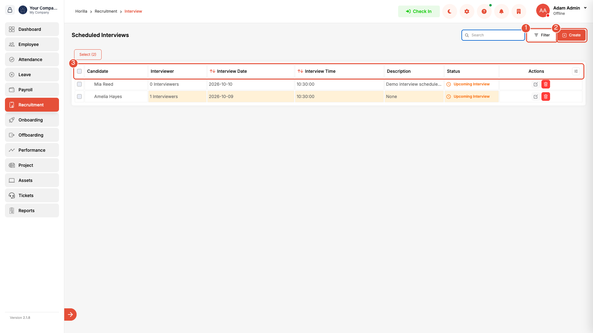
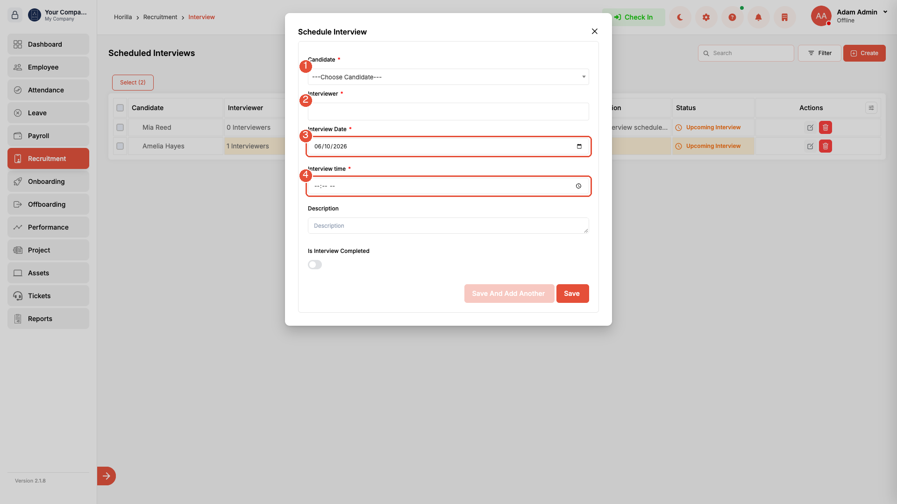

# **Interviews**

**Interviews** lists scheduled interviews and is where new ones are added. Open it from **Recruitment → Interviews**.

1. **Filter** by **Candidate** and **Interviewer**; **+ Add filter** adds more.
2. **Create** schedules an interview.
3. The table: **Candidate, Interviewer, Interview Date, Interview Time, Description, Status** and **Actions** (**Edit**, **Delete**). The demo has two, each marked **Upcoming Interview**, for example *Mia Reed, 2026-10-10, 10:30*.

## **Schedule an interview**

| Field | Required | Notes |
|---|---|---|
| **Candidate** | Yes | Chosen from the candidates. |
| **Interviewer** | Yes | One or more employees on the panel. |
| **Interview Date** | Yes | Defaults to today. |
| **Interview time** | Yes | |
| **Description** | No | Notes for the panel. |

Upcoming interviews also appear on the [Recruitment Dashboard](/hr/functional/v2.0/recruitment/dashboard).

::: info Not tested
Scheduling, editing and deleting were not exercised, so whether interviewers and candidates are notified is not described.
:::
