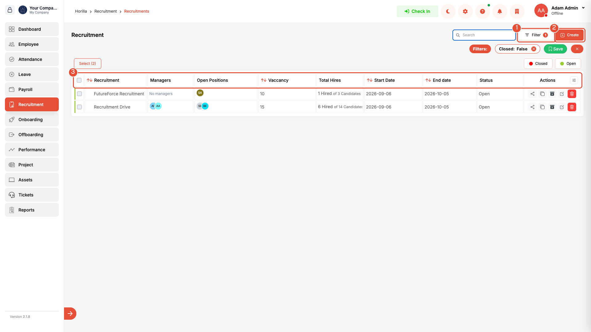
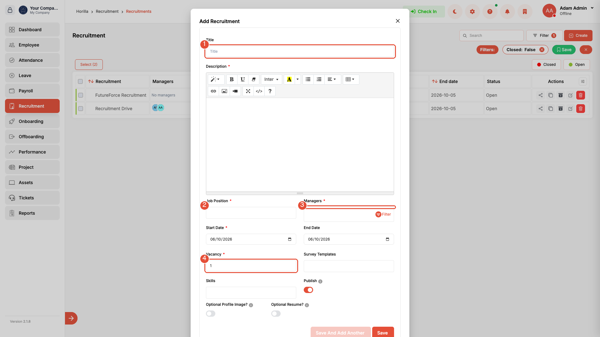

# **Job Openings**

A job opening (called a *recruitment* in the product) is a hiring drive for one or more job positions. Open it from **Recruitment → Job Openings**.

## **The page**

1. **Filter** opens a panel with **Recruitment, Managers, Company, Is Closed** (*Unknown, True, False*), **Is Published**, and under **Advanced** **Start Date From**, **Is Active?** and **Till End Date**. The page opens with **Closed: False** applied, so closed recruitments are hidden.
2. **Create** adds a recruitment.
3. The table: **Recruitment, Managers, Open Positions, Vaccancy** (spelled this way on screen)**, Total Hires, Start Date, End date, Status** and **Actions**.

The coloured dots (**Closed, Open**) filter by status. The demo has two open recruitments: **FutureForce Recruitment** (10 vacancies, *1 Hired of 3 Candidates*) and **Recruitment Drive** (15 vacancies, *6 Hired of 14 Candidates*). Each row has icons for **Share Link, Duplicate, Archive, Edit** and delete.

## **Create a recruitment**

Click **Create**. The **Add Recruitment** form opens.

| Field | Required | Notes |
|---|---|---|
| **Title** | | The recruitment's name, for example *Recruitment Drive*. |
| **Description** | Yes | Written in a rich-text editor that supports links, images and video. |
| **Job Position** | Yes | One or more positions being hired for. |
| **Managers** | Yes | The employees responsible. The picker has a **Filter**. |
| **Start Date** | Yes | |
| **End Date** | No | |
| **Vacancy** | Yes | Number of openings. Defaults to 1. |
| **Survey Templates** | No | Question templates applicants answer (see [Recruitment Survey](/hr/functional/v2.0/recruitment/survey)). |
| **Skills** | No | Skills the role needs. |
| **Publish** | | On by default. Controls whether the opening is listed for candidates. |
| **Optional Profile Image?**, **Optional Resume?** | | Switches (off by default) for whether those uploads are optional on the application. |

Click **Save**, or **Save And Add Another**.

::: info Not tested
Saving, archiving, duplicating and **Share Link** were not exercised. What **Publish** does to the public listing was not checked beyond the field's label.
:::
