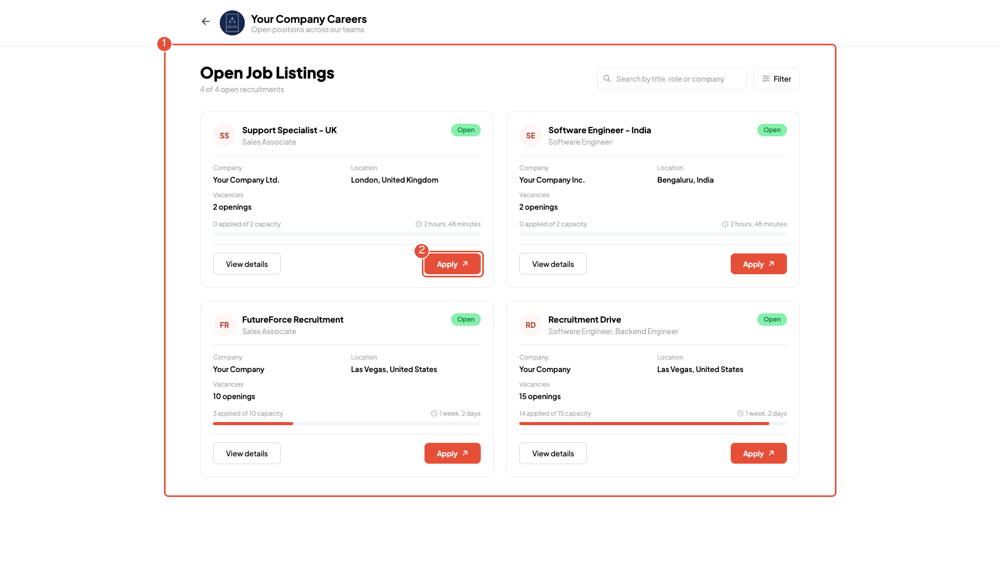

# **Open Recruitments**

**Open Recruitments** presents the open recruitments as a careers listing: the page is headed **Your Company Careers** (*Open positions across our teams*). Open it from **Recruitment → Open Recruitments**.

1. **Open Job Listings** shows how many recruitments are listed (*4 of 4 open recruitments* in the demo), with a **Filter**.
2. Each listing is a card with an **Apply** button.

A card shows the recruitment's title, the job positions, an **Open** badge, the **Company**, the **Location**, and the **Vacancies**: the number of openings and how many have applied (for example *15 openings, 14 applied of 15 capacity*), plus the time left. **View details** opens the full description.

In the demo the four listings are **Support Specialist - UK** (Your Company Ltd., London), **Software Engineer - India** (Your Company Inc., Bengaluru), **FutureForce Recruitment** and **Recruitment Drive** (both Your Company, Las Vegas).

::: info Not tested
**Apply**, **View details** and **Filter** were not used, since applying creates a candidate. Whether this page is also the public page candidates see outside Horilla, and how the **Candidate Portal** setting changes it, was not checked.
:::
