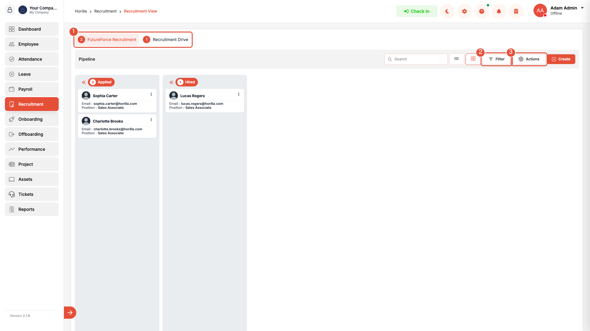

# **Recruitment Pipeline**

The pipeline shows candidates as cards in a column for each stage, one recruitment at a time. Open it from **Recruitment → Recruitment Pipeline**.

1. A tab for each open recruitment, with a count (in the demo, **FutureForce Recruitment** and **Recruitment Drive**).
2. **Filter** opens a panel with **Candidates**, **Rejection Reason**, **Phone**, **Hired Date**, **Country** and further criteria, plus **Advanced** options.
3. **Actions** offers actions for the candidates you select.

The header also has a **Search** box, a switch between the card (kanban) and **list** layouts, and **Create**. In the card layout each stage is a column headed by its name and a count (here **Applied** and **Hired**). Each candidate is a card with a photo, name, email and the position applied for, and a **⋮** menu.

::: info Not tested
Moving a candidate between stages, the **⋮** menu and **Create** were not exercised, so what moves a candidate on, who can do it, and what a stage change triggers are not described here.
:::
