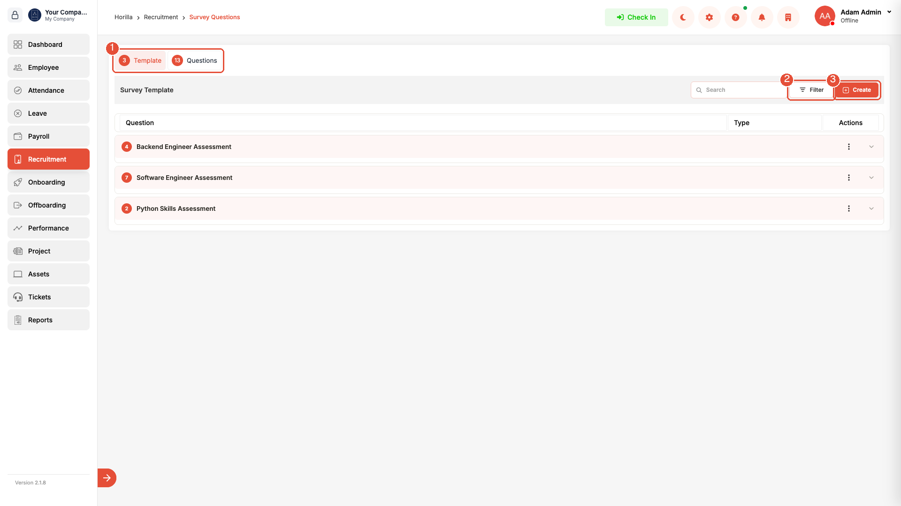
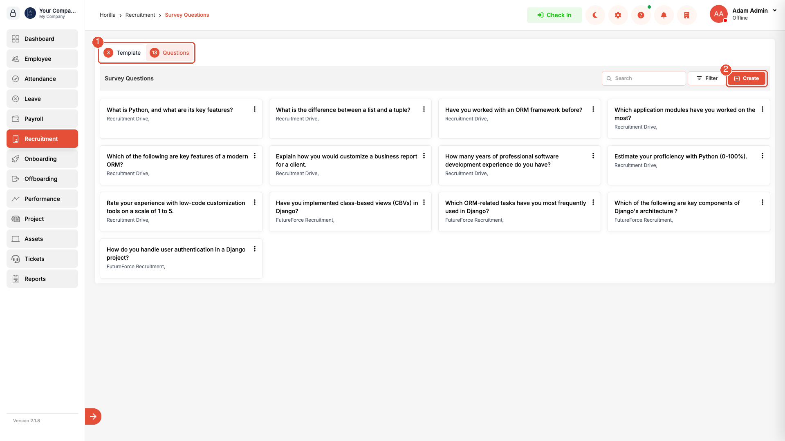

# **Recruitment Survey**

Surveys are sets of questions applicants answer when they apply. Open it from **Recruitment → Recruitment Survey**. It has two tabs: **Template** and **Questions**.

## **Templates**

1. The tabs, with a count on each (3 templates and 13 questions in the demo).
2. **Filter** narrows the list.
3. **Create** adds a template.

A template groups questions. The demo has **Backend Engineer Assessment, Software Engineer Assessment** and **Python Skills Assessment**. The template form has **Title** (required), **Description** and **Company**. A template is attached to a recruitment through **Survey Templates** on the [job opening](/hr/functional/v2.0/recruitment/job-openings).

## **Questions**

Each question is listed with the recruitments it is used in. **Filter** by **Question, Recruitment, Options** and **Question Type**.

| Field | Required | Notes |
|---|---|---|
| **Question** | Yes | The wording. |
| **Type** | Yes | **Yes/No, Choices, Multiple Choice, Text, Number, Percentage, Date, Textarea** or **File Upload**. |
| **Sequence** | Yes | The order the question appears in. |
| **Template** | No | One or more templates it belongs to. |
| **Recruitment** | No | One or more recruitments it is used in. |
| **Options** | No | The choices, for choice-type questions. |

::: info Not tested
Saving templates and questions was not exercised, and how an applicant sees the survey was not checked.
:::
