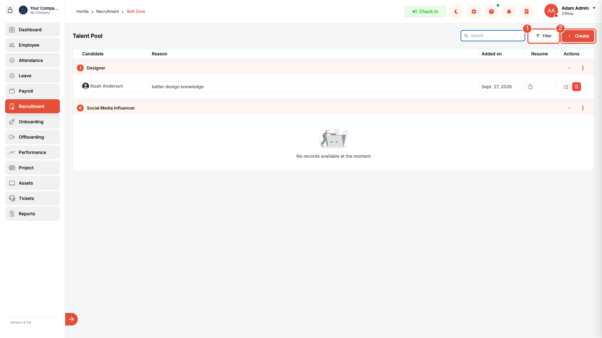

# **Talent Pool**

A talent pool keeps promising candidates for future openings. Open it from **Recruitment → Talent Pool**.

1. **Filter** opens a panel with **Candidate, Candidate Recruitment, Candidate Job Position, Rejection Reason, Joining From, Joining Till, Offer Letter Status** (*Not Sent, Sent, Accepted, Rejected, Joined*) and **Is Active**.
2. **Create** adds a talent pool. The form has a **Talent Pool** name and a **Description**, both required.

Each pool is a heading with the candidates saved in it. For each candidate the list shows **Candidate, Reason, Added on** and **Resume**, with **View resume**, **Edit** and **Remove**. The demo has two pools: **Designer**, holding *Noah Anderson* (reason: *better design knowledge*, added 27 September 2026), and **Social Media Influencer**, which is empty (*No records available at the moment*).

A candidate is added to a pool with **To Talent Pool** on the [Candidates](/hr/functional/v2.0/recruitment/candidates) page.

::: info Not tested
Creating a pool and adding or removing candidates were not exercised.
:::
