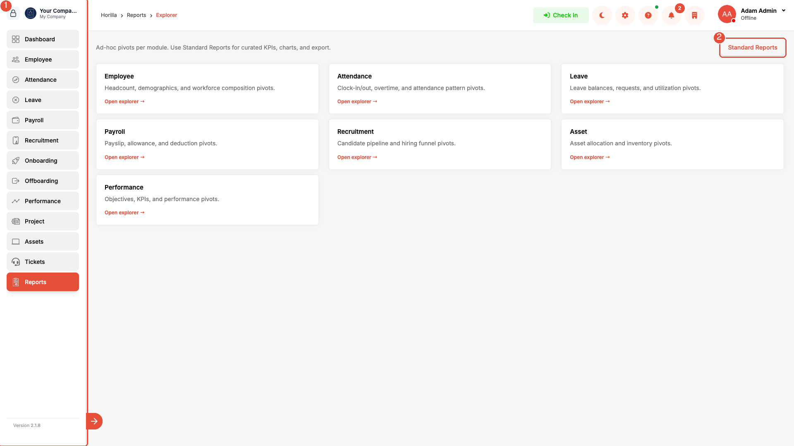
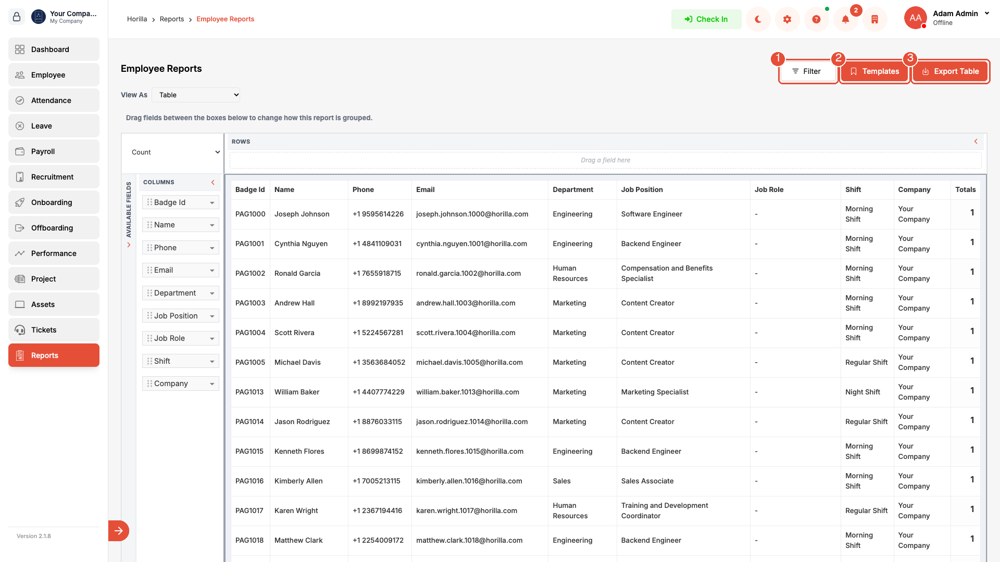

# **Explorer**

The Explorer builds ad-hoc pivot tables and charts from a module's data. Open it from **Reports → Explorer**, or with **Explorer** on the Standard Reports page.

1. One card per module, each with **Open explorer →**: **Employee** (*Headcount, demographics, and workforce composition pivots*), **Attendance** (*Clock-in/out, overtime, and attendance pattern pivots*), **Leave** (*Leave balances, requests, and utilization pivots*), **Payroll** (*Payslip, allowance, and deduction pivots*), **Recruitment** (*Candidate pipeline and hiring funnel pivots*), **Asset** (*Asset allocation and inventory pivots*) and **Performance** (*Objectives, KPIs, and performance pivots*).
2. **Standard Reports** returns to the catalog.

## **A module's explorer**

An explorer page (shown here for **Employee Reports**) has:

1. **Filter**, to limit the data.
2. **Templates**, to start from a saved layout.
3. **Export Table**, to download the current table.

Below these is a **View As** selector (**Table, Table Barchart, Heatmap, Row Heatmap, Col Heatmap, Horizontal Bar Chart, Horizontal Stacked Bar Chart, Bar Chart, Stacked Bar Chart, Line Chart, Area Chart, Scatter Chart, Multiple Pie Chart**) and an aggregation selector (**Count, Count Unique Values, List Unique Values, Sum, Integer Sum, Average, Median**, and statistical options such as variance, minimum and maximum). The page says *Drag fields between the boxes below to change how this report is grouped*: you drop fields into row and column boxes to build the pivot.

::: info Not tested
Building a pivot, saving a template and exporting were not exercised, so the result of each choice is not shown.
:::
