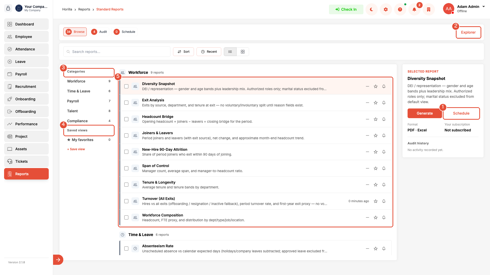
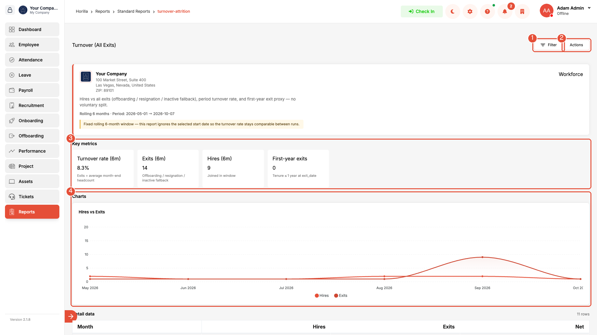
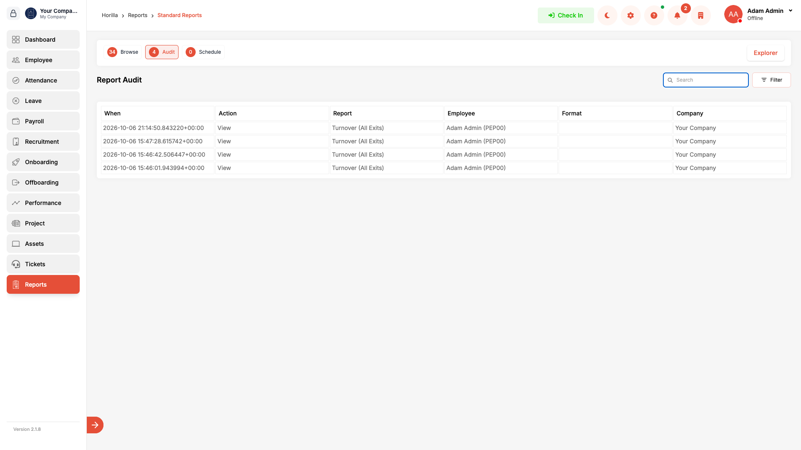

# **Standard Reports**

Standard Reports is a catalog of curated reports. Open it from **Reports → Standard Reports**.

## **The catalog**

1. The tabs: **Browse** (34 reports), **Audit** and **Schedule**.
2. **Explorer** switches to the [Explorer](/hr/functional/v2.0/report/explorer).
3. **Categories** lists the groups: **Workforce** (9), **Time & Leave** (6), **Payroll** (7), **Talent** (8) and **Compliance** (4). A **Sort** control orders the cards (for example by **Recent**).
4. **Saved views** holds your saved report views (**My favorites**, and **+ Save view**).
5. Each report is a card with a title and a one-line description. A card also shows when the report was last run.

## **The 34 reports**

**Workforce**

| Report | What it shows |
|---|---|
| Diversity Snapshot | Gender and age bands plus leadership mix. Authorized roles only. |
| Exit Analysis | Exits by source, department and tenure at exit. |
| Headcount Bridge | Opening headcount plus joiners minus leavers equals closing headcount. |
| Joiners & Leavers | Joiners and leavers for the period, net change and a month-end headcount trend. |
| New-Hire 90-Day Attrition | Share of period joiners who leave within 90 days. |
| Span of Control | Manager count, average span and manager-to-headcount ratio. |
| Tenure & Longevity | Average tenure and tenure bands by department. |
| Turnover (All Exits) | Hires against all exits, the period turnover rate and a first-year exit proxy. |
| Workforce Composition | Headcount and its distribution by department, type, job and location. |

**Time & Leave**

| Report | What it shows |
|---|---|
| Absenteeism Rate | Unscheduled absence against expected calendar days. |
| Attendance Summary | Present days, late arrivals, overtime and a department breakdown. |
| Leave Planning (Used vs Entitlement) | Approved leave days for the period against the current entitlement. |
| Open Leave Balance (Days) | Open leave balances in days (available plus carried forward) by type and department. |
| Overtime Analysis | Overtime hours by department. |
| Unscheduled Absence | Calendar-aware unscheduled absence for the period. |

**Payroll**

| Report | What it shows |
|---|---|
| Cost Composition | The mix of allowance and deduction components. |
| Labor Cost Summary | Gross, net and deductions by department. |
| Loan & Advance Ledger | Outstanding loans and advances: principal, recovered instalments and balance. |
| Payroll Headcount Cost | Gross cost per active headcount and average pay by department. |
| Payroll Readiness | Active employees who cannot be paid (missing bank details or no active contract). An empty report is good. |
| Payslip Register | A confidential payslip register for the period. Export needs export permission. |
| Reimbursement Register | Reimbursement and encashment claims by type and status. |

**Talent**

| Report | What it shows |
|---|---|
| Objective & KR Health | Objective and key-result status and progress bands. |
| Offer & Acceptance | Offer letter status mix and acceptance rate. |
| Onboarding Progress | Onboarding stage and task completion for candidates who started in the period. |
| Pipeline Aging | Age of open candidates since application, by stage. |
| Quality of Hire (90-day retention) | 90-day retention of hires in the period. |
| Recruitment Funnel | A stage snapshot of candidates plus the source mix. |
| Source Quality | Hire conversion by candidate source. |
| Time to Hire / Fill | Average and median days from application to joining, and open requisition aging. |

**Compliance**

| Report | What it shows |
|---|---|
| Asset Register | Asset inventory by status, and how long each assigned asset has been held. |
| Audit Activity | Global audit log volume by action and model. |
| Contracts & Document Expiry | Contracts ending and documents with an expiry date. |

Several cards add caveats in their own descriptions, for example that a report has *no voluntary split* of exits, or that a figure is a *proxy*. Read a report's description before quoting its numbers.

## **Open a report**

Click a card. A report page has a title, the company's name and address, a description, **Filter** and **Actions** buttons, and sections for **Key metrics**, **Charts** and **Detail data**.

1. **Filter** opens report options. On **Turnover (All Exits)** these are **a saved preset**, a **period** (*Custom range, This month, Last month, Last 30 days, Last 90 days, Last year*), a **comparison** (*No comparison, Prior period, Prior year*) and **employment status** (*Active, Inactive, All*).
2. **Actions** holds the report's actions, such as export.
3. **Key metrics**: for the turnover report, **Turnover rate (6m)** 8.3%, **Exits (6m)** 14, **Hires (6m)** 9 and **First-year exits** 0.
4. **Charts**: for the turnover report, **Hires vs Exits** by month.

Each report page ends with **Detail data**, a table of the rows behind the figures. The turnover report notes that it uses a *fixed rolling 6-month window* and ignores the selected start date, so its rate stays comparable between runs. Reports differ in their options, so check each one's **Filter**.

## **Audit**

The **Audit** tab is a log of who opened which report: **When, Action** (for example *View*), **Report, Employee, Format** and **Company**. Opening a report adds an entry.

## **Schedule**

The **Schedule** tab (0 in the demo) is for scheduled delivery of reports. It was not opened successfully, so it is not described.

::: info Not tested
Exporting, saving views, scheduling and the **Actions** menu were not exercised. Export formats are therefore not listed.
:::
