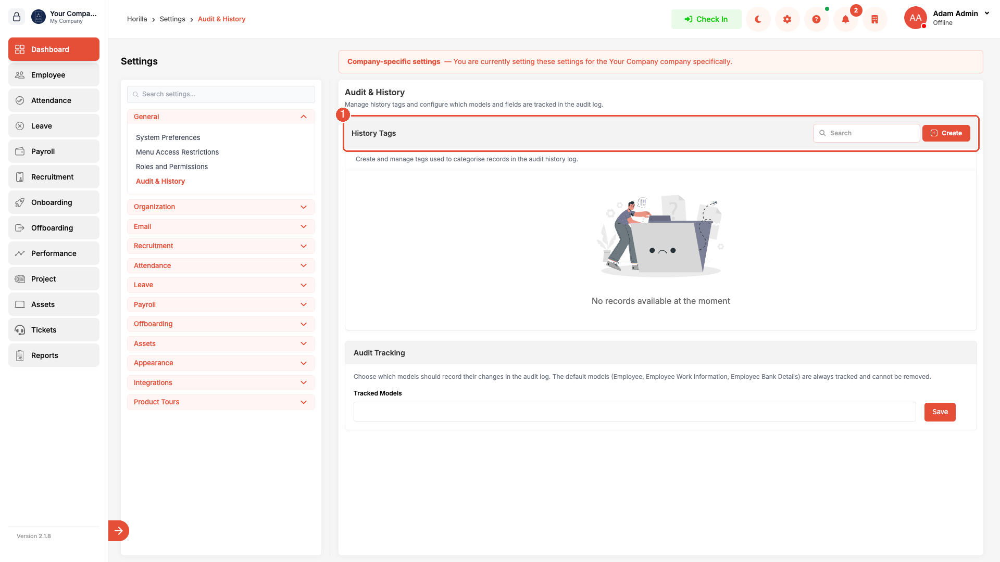

# **Audit and History**

This page has two parts: **History Tags** and **Audit Tracking**.

## **History Tags (1)**

Tags used to categorise audit history logs. The section has a search box and a **Create** button; the demo has no tags (*No records available at the moment*).

## **Audit Tracking**

Choose which models should record their changes in the audit log. The default models, **Employee**, **Employee Work Information** and **Employee Bank Details**, are always tracked and cannot be turned off. Additional models are picked in the **Tracked Models** box and saved with **Save**.

::: info Not tested
No tag or tracked model was created, and the audit log itself was not opened.
:::
