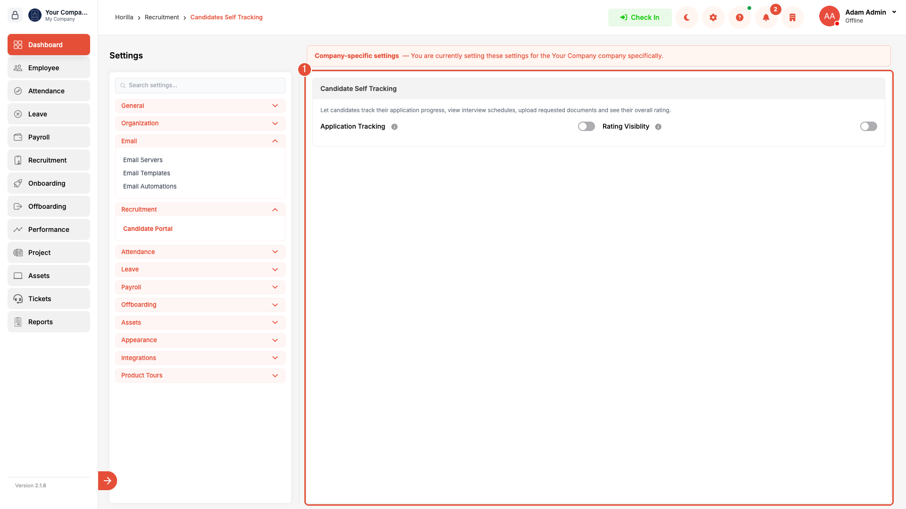

# **Candidate Portal**

The **Candidate Self Tracking** page lets candidates track their application progress, view interview schedules, upload requested documents and see their overall rating.

## **Switches (1)**

| Switch | Notes |
|---|---|
| Application Tracking | Allows candidates to track their application |
| Rating Visibility | Allows candidates to see their rating |

Both are off on the demo. It is reached from **Settings → Recruitment → Candidate Portal**.

::: info Not tested
The switches were not toggled; the candidate-side experience was not viewed.
:::
