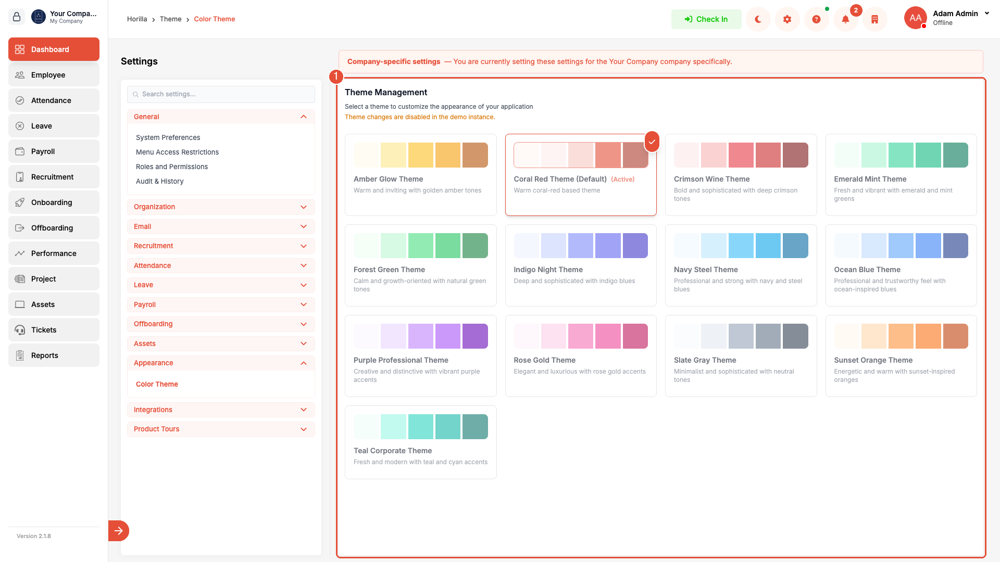

# **Color Theme**

**Theme Management** lets you pick the colour theme of the application.

## **Themes (1)**

Thirteen themes are offered as swatch cards: Amber Glow, Coral Red (the default, marked **Active**), Crimson Wine, Emerald Mint, Forest Green, Indigo Night, Navy Steel, Ocean Blue, Purple Professional, Rose Gold, Slate Gray, Sunset Orange and Teal Corporate. In the demo a note reads *Theme changes are disabled in the demo instance*.

::: info Not tested
No theme was applied on the demo.
:::
