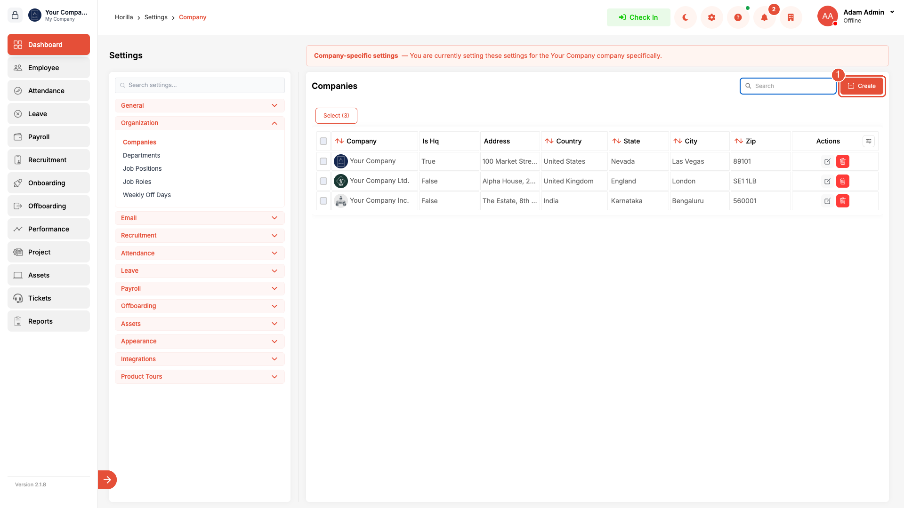

# **Companies**

Companies lists the legal entities the HR system manages. One is marked as headquarters.

## **List (1)**

Columns: **Company, Is Hq, Address, Country, State, City, Zip, Actions**. The demo has three companies: Your Company (HQ, Las Vegas, United States), Your Company Ltd. (London, United Kingdom) and Your Company Inc. (Bengaluru, India). Each row has **Edit** and **Delete**; **Create** opens the form.

## **Create / Edit form**

| Field | Required | Notes |
|---|---|---|
| Name | Yes | Company name |
| Address | Yes | Text area |
| Country | No | Choose from the list |
| State | No | Filled after a country is chosen |
| City | Yes | |
| Zip | Yes | |

The form also lets you set whether the company is the head office and add a logo.

::: info Not tested
The form was opened and its fields read; no company was created, edited or deleted.
:::
