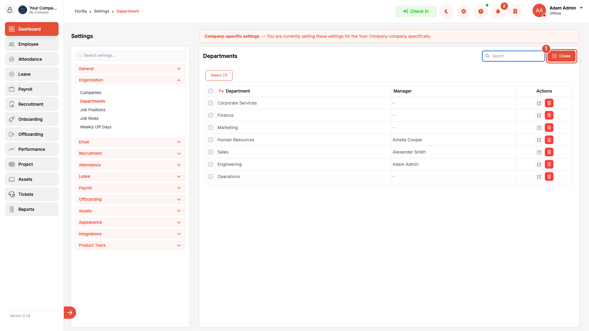

# **Departments**

Departments group employees and give each group an optional manager.

## **List (1)**

Columns: **Department, Manager, Actions**. The demo has seven: Corporate Services, Finance, Marketing, Human Resources, Sales, Engineering and Operations. **Edit** and **Delete** are in each row.

## **Form**

| Field | Required | Notes |
|---|---|---|
| Department | Yes | Name |
| Manager | No | Choose an employee, labelled with name and badge ID |

Departments are used throughout the system, for example by [Job Positions](/hr/functional/v2.0/settings/job-positions), employee work information and the helpdesk.

::: info Not tested
The form was read; nothing was created, edited or deleted.
:::
