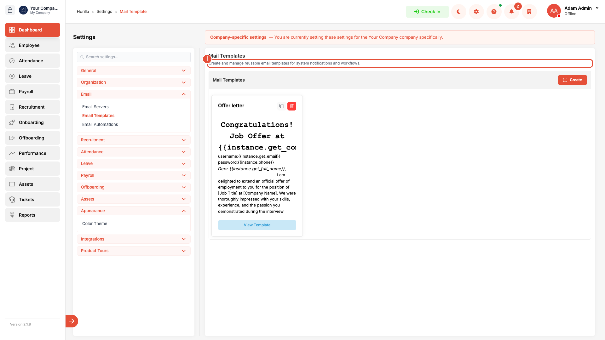
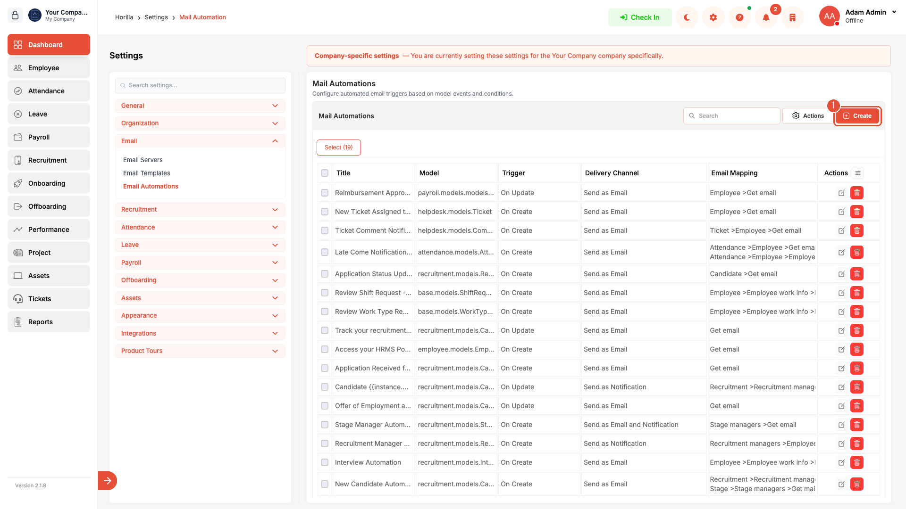

# **Email Servers, Templates and Automations**

The **Email** section has three pages.

## **Email Servers**

Where outgoing mail is configured. On the demo it shows **Primary mail is not configured!** and no server records, so the demo does not send email through a configured server. Server credentials are never shown in this documentation.

## **Email Templates**

The page (1) shows reusable email templates as cards, each with a title, a preview and the buttons **Duplicate**, **Delete** and **View Template**. The demo has one: **Offer letter**. **Create** adds a template.

## **Email Automations**

Automations (1) send emails when something happens to a record. The table lists **Title, Model, Trigger, Delivery Channel** and **Email Mapping**, and the page has a search box, **Actions** and **Create**. The demo has 19 rules, all triggered **On Create** or **On Update**, for example *Reimbursement Approved* and *New Ticket Assigned to You*. **Delivery Channel** is *Send as Email*, *Send as Notification* or both, and **Email Mapping** says who receives it (for example the employee, the reporting manager or the recruitment managers).

::: info Not tested
No server was configured, no template or automation was created or changed, and no email was sent.
:::
