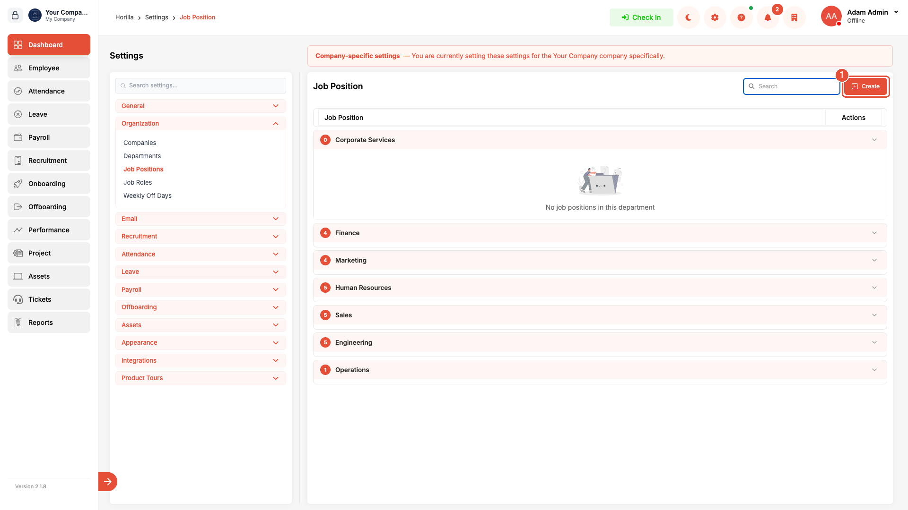

# **Job Positions**

Job positions are listed grouped by department. Click a department to expand its positions.

## **List (1)**

Each department heading expands to show its positions; empty departments show *No job positions in this department*. **Edit** and **Remove** appear on each position.

## **Form**

| Field | Required | Notes |
|---|---|---|
| Job Position | Yes | Name |
| Department | Yes | Multi-select; one position can be created for several departments |

::: info Not tested
The form was read; no position was created, edited or removed.
:::
