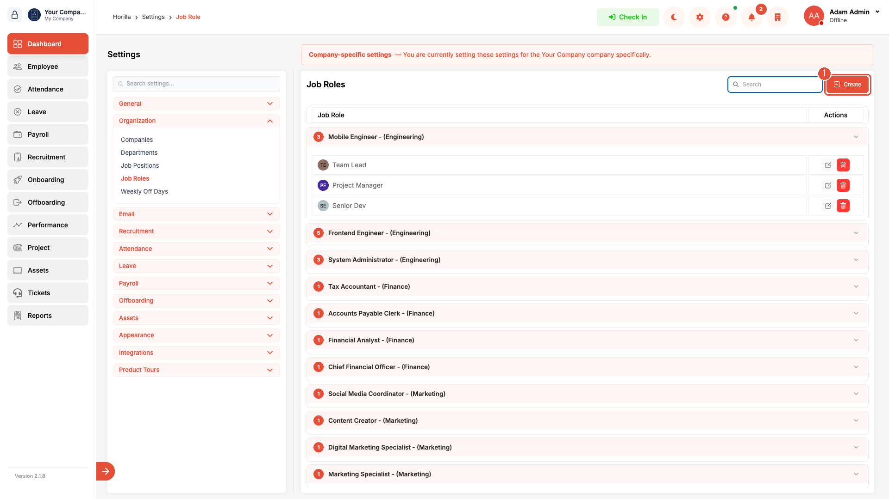

# **Job Roles**

A job role sits under a job position. Roles are listed grouped by position, shown as *Position - (Department)*.

## **List (1)**

Expand a position (for example *Mobile Engineer - (Engineering)*) to see its roles with **Edit** and **Remove**.

## **Form**

| Field | Required | Notes |
|---|---|---|
| Job Role | Yes | Name |
| Job Position | Yes | Multi-select of positions, shown with their department |

::: info Not tested
The form was read; no role was created, edited or removed.
:::
