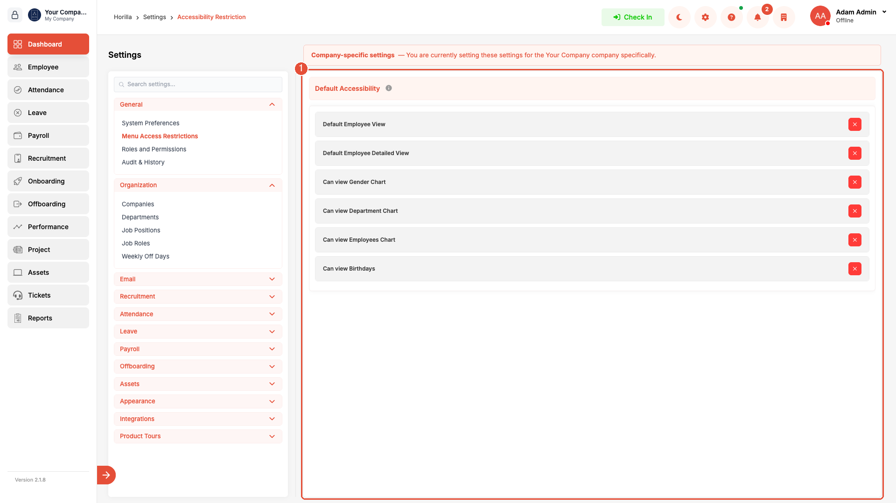

# **Menu Access Restrictions**

This page controls the **Default Accessibility** of a few employee-facing views. Each row is a switch.

## **Rows (1)**

- Default Employee View
- Default Employee Detailed View
- Can view Gender Chart
- Can view Department Chart
- Can view Employees Chart
- Can view Birthdays

The rows control whether the corresponding view or chart is available to employees by default.

::: info Not tested
The switches were not toggled, so which roles are affected and what an employee sees when a switch is off were not observed.
:::
