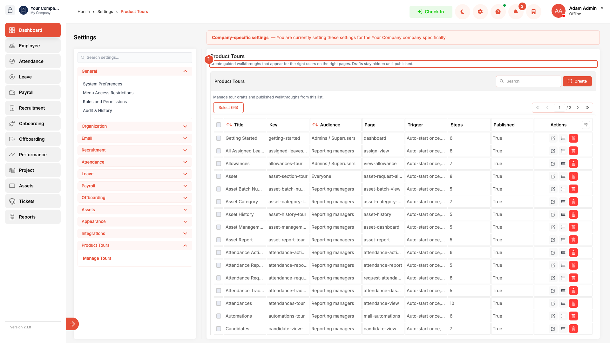

# **Product Tours**

Product Tours are guided walkthroughs that appear for the right users on the right pages. Drafts stay hidden until published. Open it from **Settings → Product Tours → Manage Tours**.

## **List (1)**

A search box and **Create** button sit above the table. Columns: **Title, Key, Audience, Page, Trigger, Steps, Published, Actions**. The demo has 95 tours across several pages, for example *Getting Started* (6 steps), shown to **Admins / Superusers** or **Reporting managers** or **Everyone**, with a trigger such as *Auto-start once*. Each row has edit and delete actions.

::: info Not tested
No tour was created, edited or unpublished.
:::
