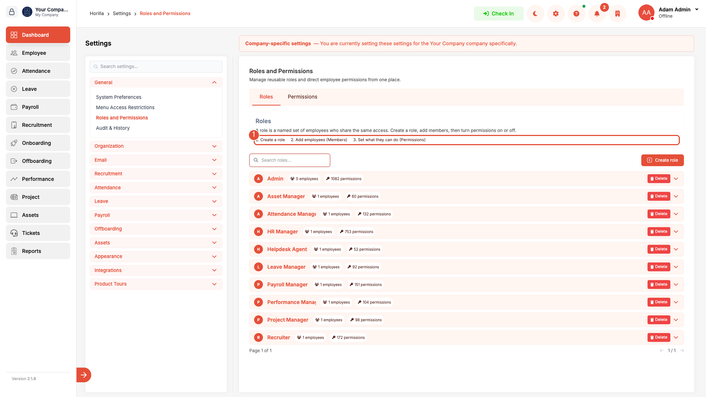

# **Roles and Permissions**

A **role** is a named set of employees who share the same access. The workflow shown on the page is: create a role, add employees (members), then turn permissions on or off.

## **The page (1)**

The page has two tabs, **Roles** and **Permissions**. Under **Roles** a search box and **Create role** button sit above the list. Each role is a row showing its name, the number of employees and the number of permissions, with a **Delete** button and an expander. The demo has ten roles: Admin, Asset Manager, Attendance Manager, HR Manager, Helpdesk Agent, Leave Manager, Payroll Manager, Performance Manager, Project Manager and Recruiter. Role names are editable text fields in the list.

The **Permissions** tab lets permissions be set directly for employees, as stated on the page: *Manage reusable roles and direct employee permissions from one place.*

::: info Not tested
Creating a role, adding members and changing permissions were not exercised, and the individual permissions inside a role were not read. Permission counts are shown as the page displays them.
:::
