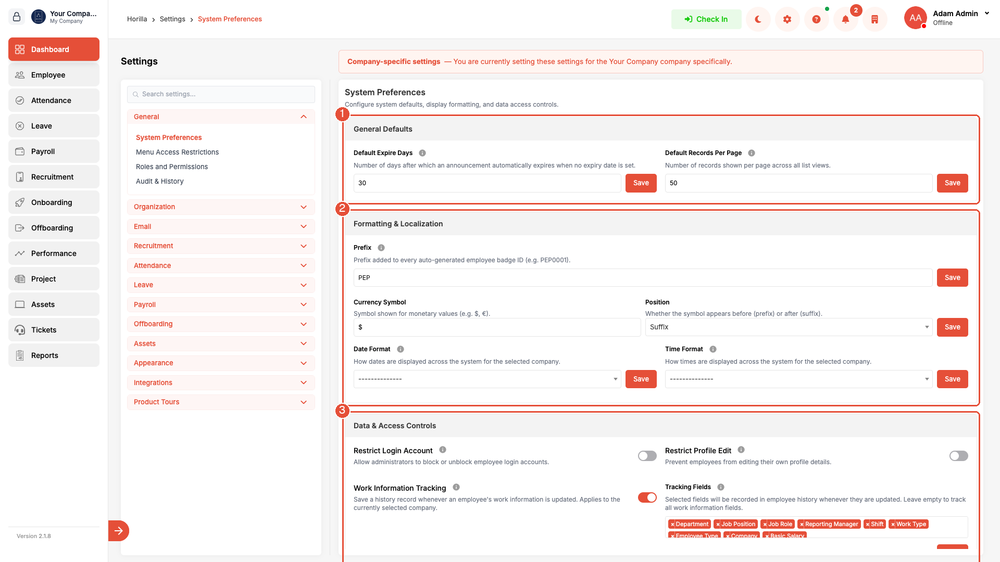

# **System Preferences**

System Preferences holds company-wide defaults, display formats, access controls and language settings. Each group has its own **Save** button, so saving one group does not save the others.

## **General Defaults (1)**

| Field | Notes |
|---|---|
| Default Expire Days | Days after which an announcement expires when no expiry date is set (demo: 30) |
| Default Records Per Page | Number of records shown per page across all list views (demo: 50) |

## **Formatting and Localization (2)**

| Field | Notes |
|---|---|
| Prefix | Added to every automatically generated employee badge ID, for example *PEP* in PEP0001 |
| Currency Symbol | Symbol used for monetary values, for example $, € or ₹ |
| Position | Whether the symbol appears before (**Prefix**) or after (**Suffix**) the amount |
| Date Format | How dates are displayed across the system |
| Time Format | **12 Hour** or **24 Hour** |

## **Data and Access Controls (3)**

| Setting | Notes |
|---|---|
| Restrict Login Account | Allows administrators to block or unlock employee login accounts |
| Restrict Profile Edit | Prevents employees from editing their own profile details |
| Work Information Tracking | Saves a history record whenever an employee's work information is updated |
| Tracking Fields | Which work-information fields are recorded (shown as removable tags, for example Department, Job Position, Shift, Work Type) |
| Default Export Access | Default access rule for exports |

## **Languages and About**

Below the controls, **Languages** lists the **Enabled Languages**, and **About** shows the product name and version (**Horilla HR 2.1.8** on the demo) with a link to the release notes.

::: info Not tested
No setting on this page was changed or saved. The effect of each switch on other modules was not observed.
:::
